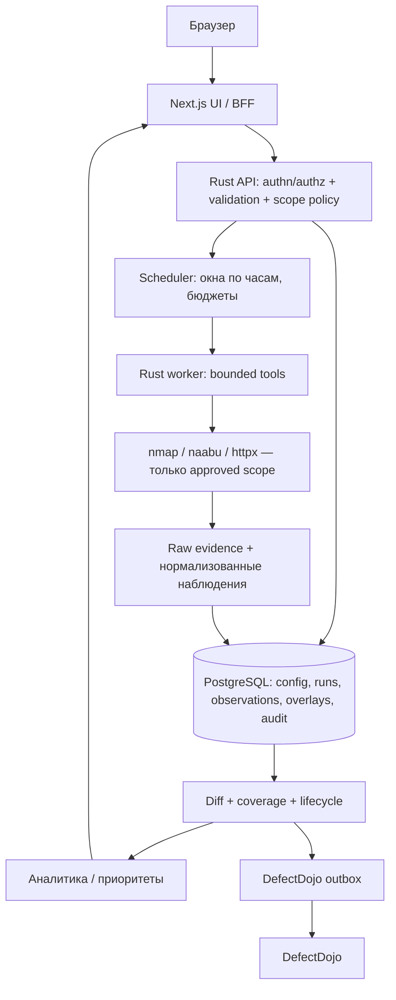

# Attack Surface Intelligence (ASI) — проектная спецификация

> **HackNation, задание №3** · Заказчик: Centrum Bezpieczeństwa Informacji, AGH (Краков) · Приз: 25 000 PLN
> **Версия 0.3 · 2026-11-21** · Ветки: работа в `dev`, в `main` — только по команде владельца репозитория.

Единый источник правды: **что строим, зачем каждая часть, что уже сделано, что сломано и в каком порядке чиним.**

| Документ | Что в нём |
|---|---|
| `docs/task3-attack-surface-intelligence.pdf` | официальное задание AGH |
| `docs/architecture-sketch.jpg` | исходная схема из 9 модулей |
| `docs/ASI_Architecture_Security_Roadmap_v2.md` | полное внешнее ревью v2: реестр находок F-01…F-27, threat model, тесты T-01…T-20, roadmap |
| `README.md` | запуск, API, демо-скрипты |

---

## 0. Коротко о состоянии

- **Что работает (ветка `dev`, проверено):** Rust-ядро с планировщиком, пайплайн discovery → сервисы → HTTP/TLS-fingerprint, окна с паузой/возобновлением, адаптивные батчи и ETA, частичное шифрование полей в Postgres, Diff Engine с повторной проверкой и статусами unstable/inactive. 21 unit-тест; сценарии прогнаны на локальной lab (`scripts/lab-scan.sh`, `scripts/diff-demo.sh`).
- **Что НЕ готово:** аутентификация/RBAC на API, политика scope, редактирование с сохранением между сканами, импорт результатов и экспорт JSON/CSV, DefectDojo, кастомные сигнатуры, окна по часам, coverage-aware diff.
- **Правило:** это прототип. **Не запускать вне изолированной lab и не открывать API в сеть**, пока не закрыты гейты SEC и SCOPE (§17). Формулировка для защиты: «основа бэкенда готова», а не «требования AGH реализованы».

---

## 1. Задача AGH

Прототип **циклического discovery-сканирования больших сетей (>10 000 IP)**: ввод IP/CIDR/доменов (вручную, CSV/JSON), безопасный многопоточный скан с окнами, частотой и ограничением темпа, активные хосты и сервисы, HTTP/HTTPS (title, код, заголовки, cookie, TLS, редиректы), технологии/CMS/IoT/админки/staging, **сравнение прогонов** (new/gone/changed), **кастомные сигнатуры без эксплуатации**, **4 роли RBAC**, **редактирование данных в любой момент с сохранением между сканами**, **шифрование чувствительных полей**, дашборд, импорт/экспорт, DefectDojo (желательно). Сдача: репозиторий, документация, ≤10 слайдов с живым демо; тест — ≥2 прогона в лаборатории AGH.

| Вес | Критерий оценки | Где закрываем |
|----:|---|---|
| **30%** | Discovery и идентификация сервисов в большой инфраструктуре | §6, бенчмарк QA-01 |
| **15%** | Изменения во времени, нестабильные хосты, отчётность | §9 |
| **20%** | Тех. качество, документация, запуск, импорт/экспорт, DefectDojo | §12, §13, §18 |
| **15%** | Безопасность работы, контроль интенсивности, дашборд | §6.3, §7, §13 |
| **10%** | Fingerprint, CMS, заголовки, cookie, сигнатуры | §8 |
| **10%** | Роли и защита данных | §10, §11 |

---

## 2. Принципы продукта

ASI — **повторяемое, ограниченное по интенсивности, авторизованное** discovery с историей наблюдений и объяснимой аналитикой изменений. Это **не** эксплойт-фреймворк и не vulnerability scanner.

1. **Безопасность сканирования важнее полноты:** только разрешённый scope, лимиты, окна, никаких логинов/брутфорса/эксплуатации.
2. **Измеримое покрытие:** у каждой цели есть итог — scanned / no_response / failed / skipped / paused — с причиной.
3. **Факт ≠ предположение:** отдельно «получен ответ», «распознана технология», «изменение достоверно», «приоритет для аналитика».
4. **Сравнивать только сопоставимое:** что не проверялось, то не «исчезло» (§9.2).
5. **Воспроизводимость:** прогон фиксирует свою конфигурацию; сырые доказательства не перезаписываются.
6. **Правки — поверх данных:** пользователь редактирует overlay (теги, заметки, false-positive, приоритет), он переживает новые сканы; evidence неизменны.
7. **Аудит:** кто, что, когда — для всех изменений и запусков.

---

## 3. Архитектура

### 3.1 Модули (по схеме) и статус

| # | Модуль | Статус в `dev` | Код |
|---|---|---|---|
| 1 | Ввод и валидация | ✅ IP/CIDR/домены, текст/CSV (1-я колонка); ❌ JSON, импорт результатов, scope-policy | `input.rs`, `api.rs` |
| 2 | Планировщик / pre-flight | ✅ повтор, окна от старта, пауза/возобновление, адаптивные батчи, ETA, recovery, cancel; ❌ окна по часам, глобальный бюджет | `scheduler.rs`, `pipeline.rs` |
| 3 | Ядро сканирования (Rust) | ✅ nmap -sn → naabu → nmap -sV → httpx; ❌ scope-guard редиректов, лимит вывода | `pipeline.rs`, `engine.rs`, `parse.rs` |
| 4 | Diff Engine | ✅ new/gone/changed, re-check, unstable→inactive, flaps, confidence, interest; ❌ учёт покрытия | `diff.rs`, `history.rs` |
| 5 | PostgreSQL | ✅ схема, миграции 0001–0004, pgcrypto для части полей; ❌ классификация всех полей | `core/migrations` |
| 6 | Frontend + API | ✅ REST API; ❌ auth, пагинация, контракт с фронтом коллеги | `api.rs`, `web/` |
| 7 | Аналитика | 🟡 interest 1–3 в диффе; ❌ теги, группировка | `diff.rs` |
| 8 | История/мониторинг | 🟡 история хостов (miss_count, flaps, first/last seen); ❌ таймлайн, время суток | `history.rs` |
| 9 | Интеграции | 🟡 сырые выводы для DefectDojo сохраняются; ❌ экспорт | `run_artifacts` |

### 3.2 Целевая схема и границы доверия



**Границы доверия:** браузер→BFF, BFF→API, API→БД, worker→цели, приложение→DefectDojo; на каждой — авторизация, таймауты, аудит. Пользовательский ввод не попадает в командную строку (уже так: цели идут файлом, порты валидируются).

**Развёртывание (MVP):** Docker Compose — `web`, `core` (API + scheduler + worker в одном бинаре; позже — отдельные entrypoint'ы API и worker), `db`, изолированная `lab`. Kubernetes/микросервисы не строим до безопасного MVP. API не выполняет скан в HTTP-запросе — только создаёт прогон.

---

## 4. Стек

| Слой | Технология | Почему |
|---|---|---|
| Ядро/worker | **Rust + tokio** | масштаб и низкий ресурс (рекомендация AGH: Go/Rust/C++) |
| Сканеры | **nmap** (Debian), **naabu, httpx** (ProjectDiscovery, пин версий + SHA-256) | порты/сервисы/HTTP-TLS; native-форматы читает DefectDojo |
| API | **axum** | один процесс, низкий ресурс |
| БД | **PostgreSQL 17 + pgcrypto** | шифрование полей, конкурентность, история |
| Frontend | **Next.js** (основа из SWOT; экраны — фронтенд-участник команды) | |
| Запуск | **Docker Compose** | `docker compose up` одной командой |

**Основа — форк SWOT** (GPL-3.0): взяты Next.js-дашборд, прокси `/api` и установщик инструментов; Python-runner заменён Rust-ядром, SQLite — Postgres, вход развернут от доменов к IP/CIDR. Из-за этого **весь проект распространяется под GPL-3.0**; если AGH это не подходит для внедрения — фронт из SWOT надо заменить.

Сканеры запускаются **без root и без capabilities** (`cap_drop: ALL`, connect-сканы `-sT` / naabu `-s c`), поэтому `NET_RAW` не нужен.

---

## 5. Данные

### 5.1 Сейчас (миграции 0001–0004)

| Таблица | Что | Шифруется |
|---|---|---|
| `users` | логин, хэш пароля, роль (4 роли) | — (API ещё не использует) |
| `targets`, `scan_targets` | нормализованные цели, связь со сканами | ❌ value/label/notes открыто |
| `scans` | **описание** скана: rate, окно, повтор, порты, батч, preflight, `inactive_after_misses` | — |
| `scan_runs` | **прогон**: статус, снимок целей, чекпоинт (смещение), окно, stats (JSON) | — |
| `hosts` | ростер прогона: адрес, hostname, state, miss_count, flaps, first/last seen | ❌ |
| `services` | порт/протокол/сервис/версия/confidence | ✅ `banner_enc` |
| `http_findings` | url, код, title, редиректы, технологии, CMS, favicon, admin/staging | ✅ headers, cookies, TLS, raw; ❌ url/title/redirects |
| `run_artifacts` | сырой вывод nmap/naabu/httpx по батчам (для DefectDojo) | ✅ |
| `diffs` | изменения run_a→run_b, kind, confidence, interest | ✅ old/new |
| `signatures`, `signature_hits`, `tags`, `audit_log` | заготовки схемы | частично |

### 5.2 Целевая модель (что меняем)

- **`scan_run` фиксирует всю политику** на старте: порты, rate, окна, порог inactive, версии инструментов/сигнатур, scope (сейчас фиксируются только цели — F-07).
- **Попытки и покрытие:** статус по каждому батчу/цели — `observed / no_response / probe_error / timed_out / skipped / policy_denied / not_attempted` (F-04). Прогон: `completed` / `completed_partial` / `failed` / `cancelled` / `paused`; отдельно `analysis_status` для диффа (F-21).
- **Overlay правок** (`annotations` / `finding_overrides`): ключ — устойчивая сущность (`ip:port/proto`, URL) на уровне скана, версия для optimistic locking, автор/время/причина. Применяется ко всем будущим прогонам; сырые данные не трогает (требование AGH п.14, F-15).
- **Ключи идентичности:** endpoint = (адрес, транспорт, порт, hostname/SNI, scheme) — различать виртуальные хосты на одном IP.

---

## 6. Пайплайн сканирования

### 6.1 Как работает сейчас

На каждый батч: **pre-flight** (`nmap -sn`, TCP-пробы на 15 портов) → **порты** (`naabu`, connect, top-100/1000/full или список) → **сервисы** (`nmap -sT -sV` только по открытым портам, `--host-timeout 90s`) → **HTTP/HTTPS** (`httpx`: title, код, заголовки, cookie, TLS, редиректы, технологии, favicon) → классификация CMS/admin/staging → запись в одной транзакции. Все инструменты получают `rate_limit_pps` скана; батчи внутри прогона идут последовательно. Тайм-аут инструмента ограничен оставшимся окном: если окно закрылось посреди батча — батч не сохраняется и переделывается в следующем окне с вдвое меньшим размером. Размер батча подстраивается под измеренную скорость (цель ~120 с, не больше `batch_size`), в stats — elapsed и ETA.

### 6.2 Что обязательно поменять

| Проблема | Решение | ID |
|---|---|---|
| Ошибка инструмента сдвигает чекпоинт, прогон всё равно `done` → ложные `gone` | статус попытки по батчу, `completed_partial`, такие прогоны не база для диффа | F-04 |
| Pre-flight **исключает** хосты, не ответившие на 15 портов | pre-flight только для приоритизации; неответившие — `unknown`, проверяются на разрешённых портах | F-06 |
| `httpx -fr` ходит по редиректам без проверки scope | убрать `-fr` до scope-guard; редиректы фиксировать, не следовать за пределы scope | F-03 |
| Вывод инструментов читается в память без лимита | потоковое чтение, лимит байт, kill по превышению | F-10 |
| Лимит темпа на прогон, а прогонов 2 | общий token bucket: глобальный → скан → подсеть | F-11 |
| Поиск батча в большом CIDR — O(смещение): 1 млн адресов ≈ 0,93 с (замер, release); /12 ≈ 30 мин CPU, /8 — дни | n-й адрес арифметикой (O(1)) | F-12 |
| IPv6 `/64` принимается, чекпоинт `i32` | лимит развёрнутого scope на скан, малые IPv6-диапазоны, 64-бит чекпоинт | F-12 |
| Некорректные строки JSONL молча пропускаются | считать ошибки парсинга, порог, показывать в stats | F-22 |
| Сохраняются полные `Set-Cookie` | по умолчанию только имена и флаги cookie | F-23 |
| httpx может обратиться к другому IP домена, чем naabu → HTTP-находка теряется | сопоставлять по hostname+порт, а не только по IP | R-04 |

### 6.3 Scope и безопасность сканирования (нет — гейт SCOPE)

- **Одобренный scope** на уровне проекта: allowlist CIDR/доменов/портов, исключения. Цели вне scope отклоняются **до** постановки в очередь (F-02).
- По умолчанию запрещены loopback, link-local, metadata (169.254.169.254), multicast; private-диапазоны — только явно разрешённые (наша lab).
- Для доменов: проверять IP **после** DNS-резолва и на каждом редиректе (DNS rebinding).
- **Preview перед запуском:** число адресов, порты, ожидаемая нагрузка и длительность.
- Kill switch: отмена всех прогонов.

---

## 7. Окна и расписание

**Сейчас:** окно = N минут от старта прогона, следующее окно через `repeat_every_minutes` (по умолчанию сутки); пауза/возобновление с чекпоинта работают (проверено).

**Требование AGH — «konkretne przedziały czasowe»** (F-20): окна по часам в часовом поясе, например:

```yaml
schedule:
  timezone: Europe/Warsaw
  weekdays: [mon, tue, wed, thu, fri]
  windows: [{start: "22:00", end: "02:00"}]   # через полночь
limits: {global_pps: 100, per_subnet_pps: 20, max_run_targets: 20000, max_http_redirects: 0}
```

Планировщик запускает/возобновляет прогон **только внутри окна**; на границе окна новые запросы не создаются. Нужны тесты: окно через полночь, смена DST.

---

## 8. Fingerprint и сигнатуры

**Сейчас:** технологии из httpx (Wappalyzer-датасет), CMS по списку, admin/staging по title/URL/hostname (эвристики). **Баг R-03:** admin ищется подстрокой во всём URL — `badminton.example.pl` даст ложное «admin»; надо токенизировать hostname.

**Сигнатуры (нет, F-26)** — декларативные данные (YAML/JSON), не код:
`id, version, name, matchers (header name/value, cookie name, favicon hash, title/body фрагмент с лимитом, TLS-свойство, safe path), condition, confidence, tags, max_requests, enabled`.
Safe paths (`/login`, `/admin`, `/version`) — только GET/HEAD, без попыток входа и без редиректов за scope. Regex — с лимитом сложности (RE2-подобный движок). Результат объясним: какая сигнатура, версия, что совпало. Nuclei с непроверенными шаблонами не запускаем.

---

## 9. Diff Engine

### 9.1 Реализовано (`diff.rs`, `history.rs`)

| Вопрос регламента | Правило |
|---|---|
| Как рапортовать изменение? | Каждый прогон сравнивается с предыдущим завершённым прогоном того же скана: host / service (`ip:port/proto`) / http (по полям). Любые два прогона — `GET /runs/{id}/diff?against=`. |
| Как отличить от шума? | Пропавшие хосты/порты **сканируются повторно** через 10 с. Не сравниваются `Date`, `ETag`, `Content-Length`, значения cookie (только имена), служебные поля TLS. |
| Уверенность? | `confidence = уверенность идентификации (nmap conf) × стабильность`, стабильность `= 1/(1+flaps)`; для пропавшего хоста — `пропуски / порог`. |
| Когда хост неактивен? | Не ответил → `unstable` («gone, не подтверждено»); после `inactive_after_misses` (по умолчанию 3) прогонов подряд → `inactive`. Пропавшие хосты переносятся в следующие прогоны; вернувшийся получает `flaps+1`. |
| Что важнее? | `interest` 1–3: новая админка/staging или «опасный» порт = 3; новый хост/сервис, смена версии/CMS/технологий/TLS/`Server` = 2; остальное = 1. |

Проверено на lab (`scripts/diff-demo.sh`): новая админка на staging — первая строка с interest 3; остановленный Apache — `unstable` (0.5) → `inactive` (1.0); вернувшийся — «reappeared», confidence 0.5; сравнение run 1 vs run 4 — без шума. Значения в `diffs` зашифрованы (проверено дампом).

### 9.2 Обязательно: coverage-aware diff (F-04, F-05, F-21)

Событие «сервис/хост исчез» допустимо, **только если одновременно:**
1. в run A объект был, и он входит в **разрешённый и фактически выполненный** план run B;
2. проверка в B дала интерпретируемый результат (не ошибка инструмента, не timeout, не skip, не редирект вне scope);
3. методики A и B сопоставимы (порты, пробы, scope);
4. выполнена повторная проверка по политике нестабильных хостов.

Иначе — `not_observed` / `out_of_scope` / `not_comparable`, но **не `gone`**. Сейчас нарушено: цель, убранная из скана, даёт `gone` (`diff.rs:126–129`, F-05); прогон с упавшими батчами становится базой сравнения (F-04); ошибка финализации диффа не видна в статусе (F-21).

Дальше (фаза 2): события подробнее (`service_new`, `http_title_changed`, `tls_certificate_changed`, …), раздельные `observation / fingerprint / change confidence` и `analyst_priority` с показом факторов, heatmap доступности по времени суток.

---

## 10. Аутентификация и RBAC (нет — гейт SEC, F-01)

**Роли из регламента:**

| Операция | Admin | Editor (добавл./удал./изм.) | Modifier (изм./чтение) | Viewer |
|---|:-:|:-:|:-:|:-:|
| Просмотр | ✓ | ✓ | ✓ | ✓ |
| Создание целей/сканов | ✓ | ✓ | — | — |
| Правки метаданных/overlay | ✓ | ✓ | ✓ | — |
| Удаление | ✓ | ✓ | — | — |
| Пользователи, ключи, интеграции | ✓ | — | — | — |
| **Запуск скана** (`scan.execute`) | ✓ | отдельное право | отдельное право | — |
| Расшифрованный evidence / экспорт raw | по праву | по праву | по праву | по праву |

Запуск скана — активное сетевое воздействие, поэтому отдельное право, а не следствие CRUD. Матрица ролей уже есть в `rbac.rs` (с тестами), но **в API не вызывается**.

**Реализация MVP:** Argon2id для паролей, первый admin при старте из секрета, короткоживущие токены / server-side сессии; если через cookie — `HttpOnly`, `Secure`, `SameSite`, CSRF для изменяющих запросов; rate limit на логин; deny-by-default extractor на **каждом** маршруте (включая SSE, экспорт, импорт); проверка владения объектом (BOLA). Токен не хранить в `localStorage`, роли из браузера не доверять. Все изменения и запуски — в `audit_log`.

---

## 11. Шифрование и секреты

**Сейчас:** `pgp_sym_encrypt` (pgcrypto) для заголовков, cookie, TLS, сырого вывода httpx, баннеров, артефактов сканеров и значений диффа. Проверено: в дампе нет открытого текста этих полей. Ключ `ASI_DATA_KEY` — из `.env`, в репозиторий не попадает.

**Пробелы (F-13, F-14, F-23, F-27):**
- открыто лежат url, title, redirects, hostnames, цели, заметки — нужна классификация каждого поля и решение (шифровать / минимизировать);
- полные значения `Set-Cookie` не хранить по умолчанию;
- ключ передаётся SQL-функции: это защищает диск и бэкапы, но не скомпрометированный сервер БД — честно указать в документации; ротации ключа нет;
- расшифрованные данные отдаются API без проверки прав — отдельное право `evidence.read`, redaction по умолчанию;
- убрать дефолтный пароль Postgres в compose для не-dev окружения, fail-fast без секретов; Docker secrets; пин образов по digest.

---

## 12. Импорт, экспорт и DefectDojo

- **Импорт целей:** текст/CSV есть; нужен JSON, лимиты размера/глубины, кавычки в CSV, O(n) дедуп (F-16, F-24).
- **Импорт результатов сканов (JSON/CSV)** — обязательный минимум AGH, нет (F-16). Импортированные наблюдения проходят тот же нормализатор, что и живые.
- **Экспорт JSON/CSV** результатов и диффов — нет. CSV-экранирование формул (`=`, `+`, `-`, `@`).
- Формат импорта/экспорта AGH обещал выдать в Discord — **запросить и делать под него**.

**DefectDojo** (проверено по живой схеме API demo.defectdojo.org v3.5.201): есть встроенные парсеры `Nmap Scan`, `Naabu Scan`, `httpx Scan`, `Nuclei Scan` и `Generic Findings Import`. План: первый прогон → `POST /api/v2/import-scan/`, следующие → `/reimport-scan/` с `close_old_findings=true`; наши наблюдения (админка, staging, диффы) — `Generic Findings Import` как **информационные** findings (новый порт — наблюдение, не уязвимость). Через outbox: свой статус экспорта, `external_id`, идемпотентность, без секретов и полных cookie; сбой экспорта не валит скан. Сырые выводы уже лежат в `run_artifacts` (nmap XML батчей перед отправкой слить в один `<nmaprun>`).

---

## 13. API и контракт с фронтендом

**Сейчас (`/api/...`):** `health`, `tools`, `targets` (GET/POST), `scans` (GET/POST), `scans/{id}/run`, `scans/{id}/runs`, `runs/{id}`, `runs/{id}/findings`, `runs/{id}/diff`, `runs/{id}/cancel`. Описание — в README.

**Проблемы:**
- фронтенд участника команды (`hacknation-vovan`) ходит в `/api/v1/...` и по умолчанию работает на **моках** (режимы `mock`/`hybrid`), а `web/` из SWOT ждёт старые эндпоинты SWOT — три несовместимых контракта (F-17, F-18);
- нет пагинации и фильтров; `findings` отдаёт весь прогон (F-19);
- нет PATCH/PUT/DELETE для правок (F-15).

**Решение:** один **OpenAPI-контракт** как источник типов; бэкенд переходит на префикс `/api/v1`; cursor-пагинация и серверные фильтры; стабильные коды ошибок; на демо — только режим `proxy` (без мок-фолбэка), всё моковое помечено `MOCK`.

---

## 14. Модель угроз (сжато, полностью — в ревью §8)

| Угроза | Контроль | Приоритет |
|---|---|---|
| Неавторизованный API / BOLA | auth middleware, deny-by-default, проверки объектов, негативные тесты | P0 |
| Скан вне scope, SSRF, DNS rebinding, редиректы | approved scope, проверка после резолва и на каждом hop, egress-политика | P0 |
| Command injection в запуске инструментов | фиксированный бинарь, типизированные аргументы, без shell (сделано) | P0 |
| DoS целей | иерархические лимиты, backoff, окна, kill switch | P0 |
| Утечка cookie/credentials/evidence | минимизация, шифрование полей, права на evidence, retention | P0 |
| Stored XSS через title/заголовки | экранирование в React, CSP, без `dangerouslySetInnerHTML` | P0 |
| SQL injection | только связанные параметры sqlx (сделано) | P0 |
| CSV formula injection, импорт-бомбы | экранирование, лимиты размера/глубины, схема | P1 |
| Подмена результатов | неизменяемые evidence, версии сигнатур | P1 |
| Supply chain | пин версий + SHA-256 инструментов (сделано), пин образов, SBOM | P1 |

---

## 15. Реестр находок

Объединено: внешнее ревью v2 (F-xx, подробности и строки — в `docs/ASI_Architecture_Security_Roadmap_v2.md` §17) и наше ревью кода (R-xx). ✔ — подтверждено нами по коду или замером. Все — **открыты**.

| ID | P | Суть | ✔ |
|---|---|---|:-:|
| F-01 | P0 | API без аутентификации/авторизации | ✔ |
| F-02 | P0 | нет scope-политики: можно сканировать любой валидный адрес | ✔ |
| F-03 | P0 | `httpx -fr` следует редиректам без проверки scope | ✔ |
| F-04 | P1 | ошибка батча сдвигает чекпоинт, прогон `done` → ложные `gone`, неполный прогон становится базой | ✔ |
| F-05 | P1 | цель убрана из скана → её хост `gone` вместо `out_of_scope` | ✔ |
| F-06 | P1 | pre-flight исключает хосты, не ответившие на 15 портов | ✔ |
| F-07 | P1 | при возобновлении настройки скана перечитываются (дрейф конфигурации в одном прогоне) | ✔ |
| F-08 | P1 | нет lease/heartbeat: несколько экземпляров core будут конфликтовать (в MVP — один экземпляр) | ✔ |
| F-09 | P1 | ошибка после отмены перезаписывает `cancelled` → `failed` | ✔ |
| F-10 | P1 | вывод инструментов читается в память без лимита | ✔ |
| F-11 | P1 | лимит темпа на прогон, нет глобального бюджета | ✔ |
| F-12 | P1 | огромные диапазоны: /8 и IPv6 /64 принимаются, чекпоинт `i32`, O(n) поиск батча (замер: 1 млн адресов ≈ 0,93 с) | ✔ |
| F-13 | P1 | шифруется только часть чувствительных полей | ✔ |
| F-14 | P1 | расшифрованные evidence и диффы отдаются без прав | ✔ |
| F-15 | P1 | нет API правок (требование AGH п.14) | ✔ |
| F-16 | P1 | нет импорта JSON и импорта результатов | ✔ |
| F-17 | P1 | фронт коллеги по умолчанию на моках | — |
| F-18 | P1 | контракты фронтов и бэкенда несовместимы (`/api/v1` vs `/api`) | — |
| F-19 | P1 | лимиты 1000/100 без пагинации; findings без пагинации | ✔ |
| F-20 | P1 | окна от старта, нет окон по часам/часовому поясу | ✔ |
| F-21 | P1 | ошибка финализации диффа скрыта, прогон всё равно `done` | ✔ |
| F-22 | P1 | битые строки JSONL молча пропускаются | ✔ |
| F-23 | P1 | хранятся полные `Set-Cookie` | ✔ |
| F-24 | P2 | квадратичный дедуп при импорте | ✔ |
| F-25 | P2 | временные списки целей в общем tmp | ✔ |
| F-26 | P2 | tlsx/nuclei объявлены, но не используются; сигнатур нет | ✔ |
| F-27 | P2 | образы без digest, дефолтный пароль БД, core в сети lab | ✔ |
| R-01 | P1 | отмена во время финализации: нет `finished_at`, дифф всё равно сохраняется | ✔ |
| R-02 | P2 | панику задачи прогона видно только после рестарта (остаётся `running`) | ✔ |
| R-03 | P2 | admin-эвристика ищет подстроку во всём URL (`badminton.*` → admin) | ✔ |
| R-04 | P2 | домен с несколькими IP: HTTP-находка может потеряться при сопоставлении по IP | ✔ |
| R-05 | P2 | CSV со значениями в кавычках не принимается | ✔ |
| R-06 | P3 | `?against=` с несуществующим прогоном → 500 вместо 404; `run_now` при активном прогоне отвечает «scheduled» | ✔ |

---

## 16. Покрытие требований AGH (по факту `dev`)

| № | Требование | Статус |
|---|---|---|
| 1 | IP/CIDR/домены | 🟡 нормализация есть; нет scope-политики |
| 2 | Безопасный discovery, многопоточность, длительность, подгруппы | 🟡 есть батчи по скорости, ETA, rate; нет глобального бюджета и окон по часам |
| 3 | Активные хосты | 🟡 есть; pre-flight может пропустить (F-06) |
| 4 | Сервисы | ✅ nmap -sV, confidence; точность на эталоне AGH не замерена |
| 5 | HTTP/HTTPS: title, код, заголовки, cookie, TLS, редиректы | 🟡 собирается; редиректы без scope-guard, cookie без минимизации |
| 6 | CMS/framework/app server/IoT | 🟡 через httpx-tech + список CMS; IoT отдельно не распознаётся |
| 7 | Staging, админки | ✅ эвристики (есть ложные срабатывания, R-03) |
| 8–9 | Сравнение прогонов, new/gone/changed | ✅ реализовано и проверено; 🟡 без учёта покрытия (§9.2) |
| 10 | Кастомные сигнатуры | ❌ |
| 11 | Ручной ввод, CSV/JSON | 🟡 текст/CSV; ❌ JSON, импорт результатов |
| 12–13 | RBAC, 4 роли | ❌ матрица есть, в API не применяется |
| 14 | Правки в любой момент с сохранением | ❌ |
| 15 | Интерфейс и дашборд | 🟡 API есть; UI — фронтенд-участник, контракт не согласован |
| 16 | Encryption at rest | 🟡 часть полей |
| мин. | Экспорт JSON/CSV | ❌ |
| мин. | Окно и частота | 🟡 длительность + интервал; ❌ конкретные часы |
| доп. | DefectDojo | 🟡 сырьё сохраняется, экспорта нет |

---

## 17. Дорожная карта

### Milestone 1 — «safe skeleton» (до полировки UI)

| Гейт | Содержание | Находки | Приёмка (тесты §18) |
|---|---|---|---|
| **SEC** | логин (Argon2id), токены/сессии, deny-by-default на всех маршрутах, 4 роли + `scan.execute`, проверки объектов, audit | F-01, F-14 | T-01, T-02 |
| **SCOPE** | approved scope (CIDR/домены/порты/исключения), отказ до очереди, проверка после DNS и на редиректах, убрать `-fr`, preview нагрузки, лимит размера scope | F-02, F-03, F-12 | T-03…T-05, T-12 |
| **EXEC** | лимит вывода инструментов, FSM статусов (cancel не перезаписывается), глобальный бюджет pps, окна по часам с часовым поясом, O(1) срез CIDR | F-09, F-10, F-11, F-20, R-01 | T-10, T-11, T-15, T-19 |
| **DATA** | снимок всей политики в прогоне, статусы попыток, `completed_partial`, `analysis_status`, coverage-aware diff, pre-flight без исключения | F-04…F-07, F-21, F-22 | T-06…T-09 |
| **AUTH-DATA** | классификация полей, только имена cookie, права на evidence, секреты без дефолтов | F-13, F-23, F-27 | T-13 |

### Milestone 2 — «AGH-ready MVP»

1. Импорт JSON/CSV **целей и готовых результатов** (версия формата, валидация, общий нормализатор) — под формат AGH.
2. PATCH/DELETE для целей, расписаний, конфигурации и overlay наблюдений (optimistic locking) — правки переживают прогоны.
3. Движок кастомных сигнатур (header/cookie/favicon/title-HTML/safe path) + тесты на fixtures.
4. OpenAPI-контракт `/api/v1`, пагинация/фильтры, сводка для дашборда (главные изменения, таймлайн по прогонам) — вместе с фронтенд-участником; убрать моки на демо.
5. Экспорт JSON/CSV и один проверенный путь в DefectDojo (outbox).
6. Полная lab, **бенчмарк 10k IP** с реальными цифрами, презентация.

### Milestone 3 — качество

Время суток и heatmap, калибровка confidence, теги/владельцы/suppression, TLS-истечение, метрики и трейсинг, бэкап/restore и ротация ключей, отдельный worker с egress-политикой, IPv6.

**Распределение:** бэкенд (`core/`, схема, Compose, lab) — мы; экраны `web/` — фронтенд-участник команды; security review критичных изменений — не автор кода.

---

## 18. Тестирование

**Есть сейчас:** 21 unit-тест (нормализация и срезы целей, парсеры на реальном выводе lab, fingerprint, RBAC-матрица, diff-сценарии, размер батча, валидация портов); clippy без замечаний по логике; ручные прогоны на lab: discovery (nginx 1.27.5 / Apache 2.4.71, conf 1.0), шифрование (0 открытых строк в дампе), окно с паузой и возобновлением в 3 окнах подряд, 4-прогонный сценарий диффа.

**Нужно (полный список — ревью §20):**

| Тест | Ожидание |
|---|---|
| T-01 Auth | без токена `POST /scans`, `GET /runs/{id}/findings` → 401, без изменений и раскрытия |
| T-02 BOLA | чужой объект → 403/404 |
| T-03 Scope | разрешённая и запрещённая цель в одном запросе → запрещённая не попадает в очередь |
| T-04/05 DNS rebinding, редирект | нет соединения вне scope, `redirect_out_of_scope` |
| T-06 Pre-flight | хост без ответа на пробы, но с открытым разрешённым портом — не теряется |
| T-07 Ошибка батча | прогон `completed_partial`, нет ложных `gone` |
| T-08 Цель убрана | `out_of_scope`, не `gone` |
| T-09 Дрейф конфигурации | после паузы прогон продолжается с прежними настройками |
| T-10 Гонка отмены | итог `cancelled` не перезаписывается |
| T-11 Лимит ресурсов | бесконечный вывод инструмента → остановка без OOM |
| T-12 Огромный CIDR | отказ/подтверждение, без переполнения |
| T-13 Шифрование | дамп БД без чувствительных данных в открытом виде |
| T-14 Импорт/правки | правка во время прогона сохраняется в следующем |
| T-15 Бюджет | два прогона не превышают общий лимит (packet capture) |
| T-16 Без моков | при выключенном бэкенде UI показывает ошибку |
| T-17 DefectDojo | повторный экспорт не создаёт дубликат |
| T-18 Масштаб | 20 000 целей / 100 000 наблюдений: пагинация, ограниченная память |
| T-19 Окно | окно через полночь и DST: нет запросов вне окна |
| T-20 Сигнатуры | опасный regex / внешний URL / команда отклоняются |

Плюс: CI (GitHub Actions: `cargo test`, `clippy`), smoke-тест с БД, бенчмарк 10k в lab.

---

## 19. Демо и презентация (≤10 слайдов)

1. Проблема AGH и масштаб. 2. Сценарий и ценность. 3. Архитектура и границы доверия. 4. Безопасность: scope, лимиты, окна. 5. Discovery 10k+: **измерения**, не обещания. 6. Fingerprint и сигнатуры. 7. Diff и нестабильные хосты (ответы на вопросы регламента, §9.1). 8. RBAC, шифрование, аудит. 9. Живое демо: импорт → скан A → изменение → скан B → дифф → DefectDojo. 10. Соответствие критериям, ограничения, roadmap.

**SecureCodeBox vs ASI** (заказчик сам называет SCB неполным; тезисы сверить с их документацией перед защитой): SCB — оператор Kubernetes (`Scan`/`ScheduledScan`, hook в DefectDojo). Мы: `docker compose up` без кластера; окна с паузой и продолжением с чекпоинта; собственный дифф прогонов с повторной проверкой и lifecycle хостов; 4 роли и шифрование полей; DefectDojo — интеграция поверх своей модели данных.

**Правило демо:** только реальные ответы API и реальные логи; моки помечены; цифры производительности — только после бенчмарка.

---

## 20. Definition of Done

(a) `docker compose up` поднимает документированное окружение; (b) разрешённые IP/CIDR/домены и импорт CSV/JSON работают; (c) два реальных lab-прогона дают корректный coverage-aware diff; (d) сканер соблюдает scope, лимиты и окна; (e) 4 роли проверяются **на сервере**; (f) данные и секреты защищены по модели угроз; (g) правки переживают повторный скан; (h) экспорт работает; (i) DefectDojo показан или честно указан как ограничение; (j) тесты, бенчмарк, документация и презентация ≤10 слайдов.

---

## 21. Источники

1. Задание AGH — `docs/task3-attack-surface-intelligence.pdf`.
2. Схема — `docs/architecture-sketch.jpg`.
3. Внешнее ревью v2 — `docs/ASI_Architecture_Security_Roadmap_v2.md` (статическая инспекция без запуска; наши динамические проверки — §18).
4. DefectDojo API: https://demo.defectdojo.org/api/v2/oa3/swagger-ui/ · Nmap: https://nmap.org/docs.html · SecureCodeBox: https://www.securecodebox.io/docs/getting-started/installation
5. Основа фронта и установщика инструментов — SWOT (GPL-3.0).
