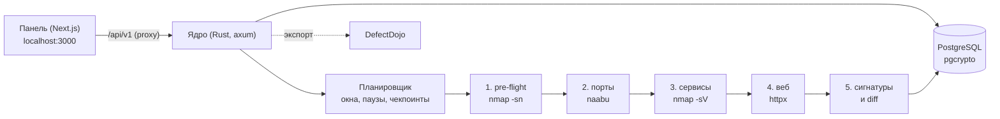

# Attack Surface Intelligence

**Видеть свою сеть так, как её видит атакующий — и замечать, что в ней изменилось.**

*System cyklicznego skanowania dużych sieci z wykrywaniem zmian w czasie — HackNation 2026, zadanie №3, CBI AGH.*

ASI по расписанию обходит большие сети (десятки тысяч адресов), безопасно и с ограничением темпа находит
живые хосты, открытые порты, сервисы и веб-приложения, распознаёт технологии — и после каждого прогона
показывает **разницу с прошлым разом**: что появилось, что пропало, что поменяло версию и какие хосты
«мигают». Аналитик работает в веб-панели на польском языке: правит данные, ставит статусы находкам,
запускает сканы, пишет свои сигнатуры, выгружает результаты в DefectDojo.

---

## Что умеет

| | |
|---|---|
| **Цели** | IP, CIDR, домены; вручную или импорт CSV/JSON; владелец, критичность, теги, исключения |
| **Безопасный скан** | сканер трогает только сети и порты, одобренные администратором; общий лимит запросов/с; аварийная остановка одним файлом; деление сети на подгруппы с адаптивным размером, оценка времени до запуска, окна по часам и дням недели (вне окна — пауза и продолжение с того же места), честный User-Agent, никаких эксплойтов; у ядра нет выхода в интернет |
| **Что находит** | живые хосты, порты, сервисы и версии (`nmap -sV`), для веба — заголовок, код ответа, заголовки, cookie, TLS, редиректы, favicon, технологии; CMS, фреймворки, панели администрирования, staging, IoT |
| **Изменения во времени** | новые / пропавшие / изменённые хосты и сервисы, повторная проверка перед «пропал», нестабильные хосты, оценка «интересности» каждого изменения, карта доступности по часам |
| **Свои сигнатуры** | правила по заголовкам, cookie, title, favicon, баннерам — только обнаружение, с проверкой на тестовых данных и импортом/экспортом |
| **Правки аналитика** | владелец, критичность, теги, заметки, статусы находок — **сохраняются при следующих сканах**, с историей правок |
| **Роли (RBAC)** | 4 встроенные роли из задания + **свои роли** из 41 права; проверка на сервере по каждому запросу, журнал аудита |
| **Защита данных** | баннеры, заголовки, cookie, заметки и сырые выводы сканеров зашифрованы в PostgreSQL (`pgcrypto`), сессии — HttpOnly-cookie + CSRF, пароли — Argon2 |
| **Импорт / экспорт** | цели и результаты в JSON/CSV, импорт результатов nmap XML, экспорт в **DefectDojo** |

## Как это работает



Каждый прогон делит сеть на подгруппы и подбирает их размер по измеренной скорости; прогресс идёт в панель
в реальном времени (SSE). После прогона ядро сравнивает результат с предыдущим, перепроверяет пропавшее и
пересчитывает сигнатуры.

## Быстрый старт

Нужен только **Docker** (Docker Desktop на Windows/macOS или Docker Engine + Compose на Linux), ~4 ГБ RAM.

**1. Настройки** — создайте `.env` с ключом шифрования и паролем первого администратора.

Windows (PowerShell):

```powershell
Copy-Item .env.example .env
function New-Secret($n) { $b = New-Object byte[] $n; [Security.Cryptography.RandomNumberGenerator]::Create().GetBytes($b); [Convert]::ToBase64String($b) }
(Get-Content .env) -replace '^ASI_DATA_KEY=.*', "ASI_DATA_KEY=$(New-Secret 32)" -replace '^ASI_ADMIN_PASSWORD=.*', "ASI_ADMIN_PASSWORD=$(New-Secret 18)" | Set-Content .env -Encoding ascii
```

Linux / macOS:

```bash
cp .env.example .env
sed -i "s|^ASI_DATA_KEY=.*|ASI_DATA_KEY=$(openssl rand -base64 32)|" .env
sed -i "s|^ASI_ADMIN_PASSWORD=.*|ASI_ADMIN_PASSWORD=$(openssl rand -base64 18)|" .env
```

По умолчанию сканировать можно только лабу `172.30.0.0/24` и 8 портов (22, 80, 443, 3306, 5432, 6379, 8080, 8443).
Свои сети и порты — переменные `ASI_ALLOWED_CIDRS` и `ASI_ALLOWED_PORTS` в `.env` (см. `.env.example`).

**2. Запуск** — база, ядро, панель и тестовая лаба:

```bash
docker compose --profile lab up -d --build
```

Первая сборка занимает 5–10 минут. Если Docker Hub отвечает `429 Too Many Requests`, соберите через зеркало:
`ASI_BASE_REGISTRY=mirror.gcr.io/library docker compose --profile lab up -d --build`.

**3. Вход** — откройте **http://localhost:3000**, логин `admin`, пароль — `ASI_ADMIN_PASSWORD` из `.env`.

Остановить: `docker compose --profile lab --profile lab2 down` (данные остаются в томе `asi_db-data`).

## Проверка на лабе через веб-интерфейс

Лаба — изолированная Docker-сеть `172.30.0.0/24` без выхода наружу: nginx на `.10`, Apache на `.11`.
Сканировать чужие сети без разрешения нельзя — для проверки достаточно лабы.

1. **Zakresy → Dodaj zakres** — добавьте `172.30.0.0/28` (имя, например, «Lab /28»).
2. **Skanowania → Nowe skanowanie** — отметьте цель, профиль **Laboratorium** (порты, одобренные
   администратором), термин **Teraz**, затем **Uruchom skanowanie**. Откроется страница скана с прогрессом и
   журналом в реальном времени; прогон /28 идёт около 15 секунд. Профили с top-100/top-1000 портов
   сканер отклонит с объяснением, пока эти порты не одобрены в `ASI_ALLOWED_PORTS`.
3. **Pulpit, Zasoby, Znaleziska** — найденные хосты, сервисы с версиями, веб-отпечатки.
4. **Измените инфраструктуру** — выключите Apache и поднимите новый хост с «админкой на staging»:

   ```bash
   docker compose --profile lab stop lab-httpd
   docker compose --profile lab2 up -d lab-admin
   ```

5. Запустите новый скан с той же целью и профилем (как в шаге 2) — ядро сравнит его с прошлым прогоном
   по тем же целям. **Zmiany** покажет новый хост `.12` с панелью администратора (высокая «интересность»)
   и пропавший Apache — сначала как нестабильный, после следующих прогонов как неактивный.
6. Дополнительно: поправьте владельца или теги хоста и пересканируйте — правка останется; создайте
   свою роль в **Administracja → Role** и войдите пользователем с ней; выгрузите результаты в JSON/CSV.

Вернуть лабу в исходное состояние: `docker compose --profile lab start lab-httpd` и
`docker compose --profile lab2 stop lab-admin`.

## Границы сканирования и остановка

- **Что можно сканировать** решает администратор сервера, а не пользователь панели: `ASI_ALLOWED_CIDRS`
  (IPv4-сети), `ASI_ALLOWED_PORTS` (порты), `ASI_EXCLUDED_CIDRS` (исключения сильнее разрешений).
  Цель вне разрешённого или порт вне списка — отказ ещё до запуска; служебные сети (loopback, link-local,
  multicast) запрещены всегда.
- **Общий лимит** `ASI_GLOBAL_PPS` делится между всеми одновременными прогонами (`ASI_MAX_RUNS`).
- **Аварийная остановка**: создайте файл `deploy/control/STOP` — запущенные сканеры прерываются, новые
  не стартуют, пока файл не удалят.
- Ядро и база живут во внутренних сетях Docker без выхода наружу; наружу опубликован только порт панели.
  Скриптам из `scripts/`, которым нужен API ядра на `127.0.0.1:8000`, — оверрайд
  `docker compose -f compose.yaml -f compose.api.yaml --profile lab up -d` (только для разработки).
- Шаблон для боевого развёртывания (HTTPS-прокси, секреты из файлов, образы по digest) —
  `compose.production.yaml` и [deploy/SECURITY.md](deploy/SECURITY.md); проверка в изолированной лаборатории —
  [docs/SECURITY-LAB-2026-11-22.md](docs/SECURITY-LAB-2026-11-22.md).

## Цифры

| Замер | Результат |
|---|---|
| Сеть /18 (16 382 адреса, 160 живых хостов), 8 портов, 1000 запросов/с | **7 мин 56 с**, найдено 160/160 хостов, 160/160 сервисов с версией, 140/140 веб-отпечатков |
| Лаба /24, top-100 портов при 100 запросах/с | 280 с |
| Лаба /28, профиль Laboratorium (8 портов) | 12–18 с |
| Шум у цели после чистки | 3 HTTP-запроса на веб-сервер, 0 «эксплойтных» путей, 0 соединений с интернетом |

Подробности и журнал всех замеров — [docs/BENCHMARK.md](docs/BENCHMARK.md), [docs/benchmarks/](docs/benchmarks/),
[docs/NOISE.md](docs/NOISE.md).

## Стек

| Часть | Технологии |
|---|---|
| Ядро | Rust: axum, tokio, sqlx; Argon2, SHA-256 сессии |
| Сканеры | nmap, naabu, httpx (ProjectDiscovery; версии закреплены, SHA-256 проверяется при сборке) |
| Данные | PostgreSQL 17 + pgcrypto |
| Панель | Next.js 16, React 19, TypeScript, Tailwind CSS 4, TanStack Query |
| Запуск | Docker Compose; контейнер ядра без root и без capabilities |

## Документация

| Документ | О чём |
|---|---|
| [PROJECT.md](PROJECT.md) | полная спецификация, модель угроз, правила diff |
| [docs/API-CONTRACT.md](docs/API-CONTRACT.md) | контракт панели и ядра (`/api/v1`): эндпоинты, права, SSE, форматы, дизайн-система |
| [docs/STATUS.md](docs/STATUS.md) | что работает и что нет |
| [docs/BENCHMARK.md](docs/BENCHMARK.md) | производительность и рассмотренные альтернативы (RustScan, SYN, `-p-`) |
| [docs/NOISE.md](docs/NOISE.md) | сколько трафика сканер создаёт у цели и как его сократили |
| [docs/DEMO-VIDEO.md](docs/DEMO-VIDEO.md) | сценарий демо-видео |
| [HANDOFF.md](HANDOFF.md) | для разработчиков: где остановились и как продолжить |

## Разработка

```bash
docker compose up -d db                       # только база
cd core && cargo test                         # тесты ядра
cd frontend && npm ci && npm run dev          # панель на встроенных демо-данных (ASI_API_MODE=mock)
```

Скрипты `scripts/*.sh` и бенчмарк ходят в API ядра напрямую — поднимайте стек с `compose.api.yaml`
(см. выше), а для бенчмарка добавьте его сеть в `ASI_ALLOWED_CIDRS`.

Панель умеет работать без ядра (`ASI_API_MODE=mock`), с ядром (`proxy`, так в Docker) или смешанно (`hybrid`) —
см. [docs/API-CONTRACT.md](docs/API-CONTRACT.md). Скрипты для лабы без панели — `scripts/lab-scan.sh`,
`scripts/diff-demo.sh`; бенчмарк — `scripts/bench/`.

Работа ведётся в ветке `dev`; `main` — стабильная версия.

## Лицензия

GPL-3.0 — установщик инструментов взят из [SWOT](https://github.com/VHJ5TmV0/SWOT) (GPL-3.0),
поэтому проект целиком распространяется под GPL-3.0.
