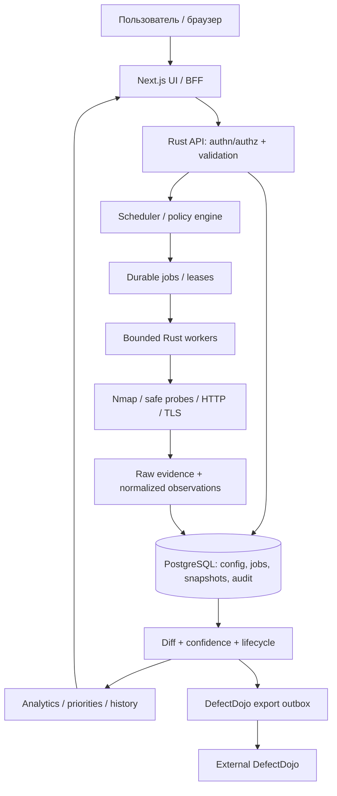

# Attack Surface Intelligence (ASI)
## Архитектура, логика продукта, безопасность и дорожная карта

**Версия:** 2.0 (расширенная техническая ревизия) · **Дата:** 2026-11-21 · **Назначение:** технический blueprint для HackNation / AGH и последующего развития.

> **Статус достоверности.** Раздел «Требования» основан на предоставленном PDF AGH; раздел «Наблюдения по коду» и дополнительная ревизия — на расширенной статической инспекции Rust core, API-маршрутов, пайплайна, миграций и обоих frontend API-proxy из двух ZIP-архивов. Остальное — проектные решения и рекомендации, **не** утверждения о том, что функции уже реализованы. Сборка Rust, динамические тесты, аудит всех React-компонентов, сканирование зависимостей и испытание на 10 000 IP не выполнялись.


## 0. Итоги повторной проверки (review v2)

**Решение технического ревью:** архитектурная концепция пригодна для прототипа AGH, но **текущие исходники не следует размещать в сети и использовать для реального сканирования** до устранения P0. Первая версия документа была в основном *целевой архитектурой* и недостаточно явно описывала разрыв между рекомендациями и уже существующей реализацией. Ниже этот разрыв исправлен. Полный реестр находок с путями, строками, проверками и исправлениями — в разделах 17–22.

### 0.1 Основные блокирующие проблемы текущего состояния

1. **API без аутентификации и авторизации:** защищённые действия доступны из обработчиков без извлечения и проверки роли (`core/src/api.rs:17–29`). Наличие таблицы `users` и `rbac.rs` недостаточно.
2. **Не реализована policy-based проверка scope:** валидный IP, CIDR или FQDN можно передать для сканирования без проверки владения диапазоном и разрешённых портов (`api.rs:209–276`; `input.rs:119–141`). Это не ограничивается только metadata/loopback.
3. **HTTP-redirect вне ожидаемого периметра:** pipeline передаёт httpx `-fr`, не проверяя промежуточные и конечные адреса по policy (`pipeline.rs:399–406`). Это риск выхода за согласованную область, а не доказанный эксплойт SSRF.
4. **Ошибки батча превращаются в «обработанное» покрытие:** pipeline смещает `offset` при ошибке (`pipeline.rs:225–231`) и затем может завершить run как `done` (`pipeline.rs:251–258`). Такие снимки нельзя трактовать как полностью успешные.
5. **Ложный `Gone` при удалении scope:** `diff.rs:126–129` явно выводит `Gone` для хоста, отсутствующего в новом roster; `history.rs:345–350` специально не переносит удалённые target. Требуется `out_of_scope`/`not_comparable`, а не `Gone`.
6. **Preflight делает false-negative:** результаты `nmap -sn` используются как единственный вход для дальнейшей проверки портов (`pipeline.rs:323–342`); хост с сервисом вне перечня `-PS` может быть исключён.
7. **Нет изоляции исходных данных от сетевых инструментов:** процесс Rust одновременно предоставляет API, запускает scan tools и имеет доступ к ключу данных и БД (`main.rs:42–44`, `pipeline.rs:420–422`). Изоляция worker/control plane описана, но не реализована.
8. **Неполное выполнение обязательного AGH:** нет подтверждённых backend API для редактирования находок, реального JSON-import результатов, полноценного server RBAC и custom-signature execution. `hacknation-vovan` по умолчанию обслуживается моками (`frontend/src/app/api/v1/[...path]/route.ts:33–36,88–104`).

### 0.2 Правила интерпретации статусов

- **Подтверждено по коду:** соответствующая ветка действительно видна в предоставленном архиве. Это ещё не означает проведённый эксплуатационный тест.
- **Не найдено в просмотренном backend:** в исследованных файлах нет реализации; возможно, она находится в другом репозитории/коммите или будет добавлена позже.
- **Риск по проектированию:** механизм частично есть, но его безопасность или корректность на нагрузке пока не доказана.
- **Рекомендация:** целевая функция, которой сейчас может не быть.

---

## 1. Цель, границы и позиционирование

ASI — система **повторяемого, ограниченного по интенсивности и авторизованного** discovery-сканирования больших инфраструктур (10 000+ IP) с накоплением исторических наблюдений, fingerprinting сервисов и объяснимой аналитикой изменений. Это **не** автоматический эксплойт-фреймворк и не замена vulnerability scanner. Приоритет — достоверная инвентаризация и выявление изменений, которые требуют проверки аналитиком.

**Основные пользователи:** SOC/CSIRT (неожиданные сервисы), пентестер (разведка разрешённого периметра), инфраструктурный администратор (дрейф конфигураций), руководитель (тренды и покрытие).

**Ключевые свойства:** безопасное сканирование; измеримая полнота покрытия; отделение факта от предположения; сравнение сопоставимых прогонов; воспроизводимость; аудит действий; удобная работа с правками без уничтожения оригинальных evidence.

### 1.1 Что прямо требует AGH

- IP/CIDR/домены, ручной ввод и CSV/JSON, импорт результатов.
- Безопасный многопоточный discovery, обнаружение хостов и сервисов, длительность, адаптивное разбиение, rate limiting и окна сканирования.
- HTTP/HTTPS: title, status, headers, cookie, TLS, redirects; CMS, framework, application server, IoT, staging/admin.
- Два и более прогона, new/gone/changed, нестабильные хосты, custom signatures без эксплуатации.
- RBAC: admin; create/delete/update; update/read; read-only; редактирование данных независимо от статуса скана и сохранение правок.
- Защита чувствительных данных at rest; dashboard; JSON/CSV export; интеграция DefectDojo (желательна).
- Репозиторий, документация, презентация **до 10 слайдов**, работающий demo.

**Вес оценки:** discovery 30%; diff/нестабильность/отчётность 15%; инженерное качество/документация/интеграции 20%; безопасное сканирование/dashboard 15%; fingerprint/signatures 10%; RBAC/защита данных 10%.

## 2. Анализ исходных материалов и текущего состояния

| Источник | Подтверждённое наблюдение | Вывод |
|---|---|---|
| `architecture-sketch.jpg` | Девять модулей: input, scheduler, Rust engine, diff, PostgreSQL, frontend/API, analytics, history, integrations | Правильное функциональное деление, но схема не показывает trust boundaries, очередь задач, модель evidence и полномочия |
| `task3-attack-surface-intelligence.pdf` | Основной акцент на безопасном discovery, изменениях и верификации в лаборатории | Нельзя подменять discovery активной эксплуатацией или «высоким количеством findings» |
| `hacknation-dev.zip` | Rust core (`api`, `scheduler`, `pipeline`, `diff`, `fingerprint`, `rbac`), SQL migrations, Next.js web, Compose, тестовые fixtures | Сильная база для backend и интеграции; готовность нужно подтвердить тестами |
| `hacknation-vovan.zip` | Next.js frontend, API client, UI, моковые обработчики, sample CSV/JSON/YAML | Сильная база для интерфейса и демо; mock-поведение нельзя выдавать за подтверждённый backend |
| `hacknation-dev/core/src/api.rs` | Комментарий `TODO(C): auth + RBAC extractor ... on every route`; маршруты `/api/targets`, `/api/scans`, `/api/runs/...` | **P0: проверить и внедрить серверную авторизацию на каждом защищённом endpoint** |
| `hacknation-dev/core/src/rbac.rs` | Матрица четырёх ролей и unit tests | Модель прав есть; её вызов в API нужно доказать интеграционными тестами |
| `hacknation-dev/compose.yaml` | PostgreSQL 17, Rust core, web, локальная lab; core/web привязаны к `127.0.0.1`, контейнеры `cap_drop: ALL` | Хорошие начальные ограничения; есть dev-default пароль БД, отсутствует доказательство полноценного encryption-at-rest |
| `hacknation-dev/core/src/scheduler.rs` | Polling БД, semaphore, восстановление running→paused, claim с `SKIP LOCKED` | Основа оркестрации есть; проверить границы окна, lease, отмену и идемпотентность |

**Важно:** в текущем pipeline *действительно используется* `pgp_sym_encrypt` для ряда полей и raw artifacts (`pipeline.rs:423–433,488–514`), но это **частичное** шифрование, а не подтверждённый encryption-at-rest для всех чувствительных данных: URL/title/redirects/hostnames/target notes и другая metadata хранятся открыто, исходные cookies могут сохраняться в raw; ключ передаётся SQL-функции. Также UI RBAC и моковая сессия не заменяют backend enforcement.

### 2.1 Решение по объединению веток

**Рекомендуемая схема:** `hacknation-dev` — backend и инфраструктурный baseline; `hacknation-vovan` — источник UI-компонентов, UX-паттернов и экранов. Не копировать оба frontend целиком. Сначала определить единый OpenAPI contract и единый набор типов; затем переносить компоненты, удаляя mock зависимости.

**Последовательность:** (1) зафиксировать коммиты обеих веток; (2) снять endpoint inventory; (3) описать OpenAPI и error schema; (4) добавить contract tests; (5) адаптировать frontend API client; (6) заменить mock handlers реальными запросами; (7) проверить права и ошибки; (8) провести e2e в lab; (9) только после этого объединять в main.

## 3. Целевая архитектура



**Trust boundaries:** браузер→BFF; BFF→API; API→БД; worker→сканируемые цели; приложение→DefectDojo. Каждый переход имеет собственную авторизацию, сетевые ACL, timeout и аудит. Пользовательский ввод не превращается напрямую в аргументы командной строки.

### 3.1 Развёртывание

- **Целевая MVP-конфигурация (не текущая реализация Compose):** Docker Compose: `web`, `core-api`, `worker` (может быть одним Rust binary с разными entrypoints), `postgres`, опциональная изолированная `lab`.
- **Следующий этап:** выделенная очередь (например, PostgreSQL-backed jobs сначала, Redis/NATS только при подтверждённой необходимости); отдельные worker pools по зонам сети; KMS/secrets manager.
- **Принцип:** API не выполняет длительный скан в HTTP request; API только создаёт job и возвращает ID.
- **Не смешивать:** control plane (пользователи, настройки, права) и data plane (пакеты и ответы целевых хостов).

## 4. Модель данных и неизменяемость наблюдений

**Сущности:** `organizations`/`projects`, `users`, `memberships`, `scopes`, `targets`, `target_labels`, `scan_policies`, `schedules`, `scan_runs`, `scan_tasks`, `observations`, `services`, `http_observations`, `tls_observations`, `fingerprint_matches`, `signature_versions`, `diff_events`, `analyst_annotations`, `evidence_blobs`, `export_jobs`, `audit_events`.

**Ключи идентичности:**
- `asset_id`: стабильный идентификатор сущности; DNS и IP не считать эквивалентными навсегда.
- `endpoint_key`: `(asset_id, transport, port, hostname/SNI, scheme)`; важно различать виртуальные хосты на одном IP.
- `observation_key`: `(run_id, endpoint_key, probe_type)`; наблюдение привязано к конкретному времени и методике.
- `scan_run`: immutable snapshot конфигурации (scope, версии инструментов/сигнатур, policy, окно, порты, DNS resolution).

**Правки:** сырые результаты и доказательства immutable; пользователь редактирует **overlay** (название, владелец, теги, false-positive, приоритет, комментарии, suppression), который переживает следующие сканы. Каждая правка содержит автора, время, причину и предыдущую версию. Не перезаписывать автоматически импортированные или исходные evidence.

**Статусы run:** `queued → preflight → running → finalizing → completed`; дополнительные `paused`, `cancelled`, `failed`, `partial`. `partial` не сравнивать как полный snapshot без маски покрытия.

## 5. Пайплайн сканирования

### 5.1 Intake и scope control

1. Принимать IP/CIDR/FQDN, CSV/JSON и отдельный режим импорта результатов.
2. Ограничить размер файла, количество записей, расширение CIDR, длину строк, глубину JSON; stream parsing, dedup, canonicalization.
3. Зафиксировать **разрешённый scope** (allowlist сетей/доменов/портов, исключения, временные окна, owner approval). По умолчанию запрещать loopback, link-local, metadata endpoints, multicast, private ranges вне явно разрешённой лабораторной/внутренней политики.
4. Для доменов сохранить исходный FQDN, resolved IP, TTL и время резолвинга. Повторно проверять разрешённость IP **после DNS resolution и на каждом redirect** (защита от DNS rebinding/SSRF).
5. Preview до запуска: число IP, подсети, порты, ожидаемая нагрузка, примерное время, исключения и потенциальные конфликты с правилами сканирования.

### 5.2 Preflight и discovery

- Preflight **не должен безусловно отбрасывать «мёртвые» IP**: ICMP/ARP может быть запрещён, а TCP доступен. Состояние `unknown/unresponsive` не равно `inactive`.
- Для каждого target: выбрать доступные probe types по policy; использовать небольшие разрешённые порты, ограниченные таймауты и ретраи; затем проверять сервисы.
- Структурированный вывод Nmap (XML), ограниченные профили, строгие аргументы без shell interpolation; парсер не должен доверять баннерам.
- Не включать по умолчанию intrusive NSE, brute-force, auth attempts, crawling вне разрешённых путей, fuzzing или эксплуатацию. **Текущий код запускает `nmap -sV` и `httpx -fr`, поэтому их фактическое сетевое поведение должно проходить отдельный safety-review; `-fr` убрать до реализации проверки redirects по scope.**
- Оценивать продолжительность из фактической скорости и числа оставшихся задач; показывать доверительный диапазон ETA, а не гарантированное время.

### 5.3 Масштабирование 10 000+ IP

**Иерархия лимитов:** глобальный budget → project → CIDR/ASN/zone → host → endpoint. Token bucket для запросов/сек; отдельные лимиты concurrency и bandwidth. Консервативные значения по умолчанию должны быть конфигурируемыми согласно правилам AGH, не захардкоженными «агрессивными» профилями.

**Batching:** chunk по адресам/подсетям с учётом RTT, ошибок, таймаутов, density активных хостов; динамически уменьшать нагрузку при росте timeout/5xx/connection reset. Weighted fair scheduling, чтобы одна большая подсеть не блокировала остальные.

**Window enforcement:** перед каждым батчем проверить deadline; при закрытии окна остановить создание новых задач, завершить или безопасно отменить in-flight, сохранить checkpoint и lease. Возобновление в следующем окне — **из оставшегося checkpoint**, без повторного широкого скана, если это разрешено условиями задания. В отчёте различать «прерван» и «неактивен».

**Failure semantics:** at-least-once job delivery + idempotent writes; task lease/heartbeat; уникальные ключи для повторных результатов; bounded retries с jitter; dead-letter состояние для неуспешных задач. На shutdown — graceful drain.

### 5.4 HTTP/HTTPS fingerprinting

Собирать URL (без секретов), scheme, status, title, конечный URL, redirect chain (с лимитом hops), selected headers, **имена cookie и безопасные атрибуты**, TLS version/issuer/subject/SAN/notAfter/fingerprint, server hints, favicon hash, content hash/length. Не сохранять значения session cookies и Authorization headers без отдельной необходимости и шифрования; не собирать тела страниц целиком по умолчанию.

Для HTTP использовать явные `Host` и SNI; учитывать несколько виртуальных хостов. Ограничивать размер body, decompression ratio, redirects, время ответа; блокировать переходы за scope. В fingerprint evidence фиксировать точный признак, сигнатуру, версию и время.

### 5.5 Пользовательские сигнатуры

**Декларативный формат** (YAML/JSON): `id`, `version`, `name`, `matchers` (header name/value regex, cookie name, favicon hash, title/body bounded match, TLS property, safe path), `condition`, `confidence`, `tags`, `max_requests`, `enabled`.

- Сигнатуры — **данные**, не исполняемый Python/JS/shell; запрещены произвольные команды и сетевые URL за scope.
- Regex с лимитами времени/сложности (или RE2-подобный движок); предел длины и числа matcher.
- Safe paths `/login`, `/admin`, `/version` только GET/HEAD, без попыток входа; ограничения по HTTP method и redirect.
- Подпись/версионирование каталога, dry-run на fixtures, ревью перед публикацией, тесты false-positive/false-negative.
- Объяснимость: `matched_evidence`, `signature_version`, `confidence`, `reason`.

## 6. Diff Engine, нестабильность и доверие к данным

### 6.1 Корректное сравнение

Сравнивать только **сопоставимые** прогоны: одинаковый scope или пересечение scope, сопоставимый набор портов/проб, завершённые области, время и версия методики. Если target не был покрыт — `not_observed`, **не** `gone`.

**Типы событий:** `host_discovered`, `host_unresponsive`, `service_new`, `service_missing`, `port_state_changed`, `http_title_changed`, `http_status_changed`, `tls_certificate_changed`, `technology_added/removed`, `signature_match_changed`, `dns_resolution_changed`, `evidence_changed`.

**Нормализация:** игнорировать случайные timestamps, tracking IDs, динамические query params и другие шумовые поля; хэшировать канонизированное представление. Хранить старое/новое значения с redaction и evidence pointers.

### 6.2 Lifecycle вместо ложных «исчезновений»

`new → confirmed_active → intermittently_unresponsive → suspected_inactive → inactive`; при новом ответе `reactivated`. Порог переходов задаётся политикой, например 3 **сопоставимых и успешно завершённых** цикла без ответа; это стартовая гипотеза, требующая проверки на лабораторных данных. Не использовать простой timeout как доказательство удаления хоста.

Для нестабильных хостов — повторные наблюдения в разных временных слотах и heatmap доступности. Не объединять «хост не отвечает ночью» с «хост исчез навсегда».

### 6.3 Confidence и аналитический приоритет

Разделить:
- `observation_confidence`: достоверность факта (получен TCP SYN/ACK, HTTP 200 и т.д.).
- `fingerprint_confidence`: достоверность распознанной технологии (несколько независимых признаков лучше одного заголовка).
- `change_confidence`: сопоставимость и повторяемость изменения.
- `analyst_priority`: важность **для проверки**, не «уровень уязвимости».

Пример приоритета (настраиваемые веса): новизна сервиса + публичная экспозиция + admin/staging признак + редкая технология + уверенность + критичность владельца − шум/подтверждённая легитимность. Показывать факторы, не выдавать score за CVSS или подтверждённую уязвимость.

## 7. API, UX и права

### 7.1 API contract

Рекомендуемые ресурсы: `/api/v1/targets`, `/scopes`, `/policies`, `/scans`, `/runs`, `/runs/{id}/events`, `/runs/{id}/observations`, `/runs/{id}/diff`, `/assets`, `/signatures`, `/imports`, `/exports`, `/integrations/defectdojo`, `/audit`. OpenAPI как источник типов frontend. Пагинация cursor-based; фильтры server-side; стабильные error codes; request IDs; idempotency key для запуска.

**События:** SSE для прогресса с `Last-Event-ID`, ограниченным retention и обязательной авторизацией; polling fallback. События не должны включать сырой чувствительный evidence.

### 7.2 Матрица ролей

| Операция | Admin | Editor (CRUD) | Modifier (read/update) | Viewer |
|---|---|---|---|---|
| Просмотр разрешённых данных | ✓ | ✓ | ✓ | ✓ |
| Создание target/scan | ✓ | ✓ | — | — |
| Редактирование метаданных/пометок | ✓ | ✓ | ✓ | — |
| Удаление объектов | ✓ | ✓ | — | — |
| Управление пользователями/ключами/integrations | ✓ | — | — | — |
| Запуск сканирования | ✓ | По отдельному permission | По отдельному permission | — |
| Экспорт raw evidence | По permission | По permission | По permission | По permission |

**Рекомендация:** запуск сканирования — отдельное действие `scan.execute`, потому что это активное сетевое воздействие; CRUD роль сама по себе не должна автоматически давать его. Добавить project-level membership и object-level checks (IDOR/BOLA), а не только глобальную роль.

### 7.3 UX / dashboard

**Overview:** число охваченных IP, coverage %, новые сервисы, suspected inactive, high-interest изменения, успешность сканов, длительность, throughput, последний завершённый run.

**Assets:** поиск по IP/CIDR/domain/service/tech/tag, история endpoint, evidence и ручные annotations.

**Runs:** timeline этапов, прогресс `processed/total`, ETA диапазон, пропущенные цели с причиной, pause/resume/cancel.

**Diff:** old/new, фильтр по типу и confidence, сравнение двух выбранных run, suppression с причиной.

**Signatures:** редактор declarative rules, test-on-fixtures, версия и approval.

**Administration:** пользователи/роли, scope policies, schedules, лимиты, ключи интеграций, audit trail.

**Требование к демо:** везде явно обозначать `Demo/mock` vs `Live`; не показывать синтетические результаты как настоящие наблюдения. Для реального демо запускать `ASI_API_MODE=proxy`, а режим `hybrid` (fallback на mock при сетевой ошибке) отключить. Backend `/api/*` и frontend `/api/v1/*` пока несовместимы по контракту.

## 8. Threat model и security controls

### 8.1 Основные угрозы

| Угроза | Воздействие | Контроль | Приоритет |
|---|---|---|---|
| Неавторизованный API / BOLA | Чтение/запуск/изменение чужих сканов | Auth middleware + object policy + deny-by-default + integration tests | P0 |
| SSRF / DNS rebinding / redirects | Доступ к внутренним сервисам и metadata | Scope enforcement после DNS и каждого redirect, network egress policy | P0 |
| Command injection в Nmap/tool runner | RCE в контейнере worker | `Command` с фиксированным executable и typed args, без shell, allowlisted options | P0 |
| Сканирование вне разрешённого scope | Инциденты и нарушение правил | Signed/approved scope, hard-deny ranges, preflight, audit | P0 |
| DoS целевых сервисов | Деградация сети | Hierarchical rate limit, bounded concurrency, backoff, stop windows | P0 |
| Утечка credentials/cookies/evidence | Компрометация пользователей | Redaction, field-level AEAD, KMS, least privilege, retention | P0 |
| Подмена результатов и false findings | Неверные решения аналитиков | Immutable evidence, provenance, versioned signatures, signed exports | P1 |
| Stored XSS через title/headers | Компрометация UI | React escaping, CSP, запрет `dangerouslySetInnerHTML` для evidence | P0 |
| SQL injection | Доступ к данным | SQLx bound parameters, запрет динамической SQL-конкатенации | P0 |
| CSV formula injection | Исполнение формул при открытии | Escape значений, начинающихся с `=`, `+`, `-`, `@`, tab/CR | P1 |
| YAML/JSON import abuse | Memory/CPU exhaustion | Size/depth limits, safe parser, schema validation | P1 |
| Злоупотребление интеграцией | Утечка наружу, дубликаты | Allowlisted URL, scoped token, outbox, idempotency | P1 |
| Supply-chain compromise | Подмена scanner/container | Pinned images/digests, SBOM, dependency scanning, signed releases | P1 |

### 8.2 Аутентификация и сессии

Предпочтительно OIDC/SSO; для MVP — безопасная локальная auth с Argon2id, MFA при доступности, защищённой server-side session или короткоживущими токенами. `HttpOnly`, `Secure`, `SameSite` cookies, CSRF защита для cookie-auth mutating endpoints, login rate limit, session revocation, audit. Не хранить access token в `localStorage`. Никогда не доверять роли из браузерского состояния.

### 8.3 Шифрование и секреты

- **In transit:** TLS браузер→BFF; TLS/mTLS между сервисами вне одного доверенного host; TLS к PostgreSQL при сетевом подключении.
- **At rest:** шифрование volume/disk **и** field-level AEAD (например, AES-256-GCM) для секретов, sensitive evidence и cookie values, если они вообще сохраняются. Уникальные nonces, key IDs, rotation, separation of duties.
- **Ключи:** secrets manager / Docker secrets; `ASI_DATA_KEY` не коммитить и не печатать; backup ключей отдельно от backup БД.
- **Пароли:** убрать `asi-dev-password` fallback из production; fail-fast без обязательных секретов.
- **Минимизация:** headers и cookies могут содержать персональные данные; по умолчанию хранить безопасные подмножества/хэши, включать полные данные только по утверждённой политике.
- **Retention:** конфигурируемые сроки для raw evidence, events, logs и audit; безопасная очистка, экспорт и контроль доступа.

### 8.4 Изоляция контейнеров и сканирующего движка

Rootless/non-root, `read_only`, `tmpfs` для временных файлов, seccomp/AppArmor, `no-new-privileges`, `cap_drop: ALL`, ограничения CPU/memory/PIDs, отдельная egress policy. **Нюанс:** некоторые режимы Nmap требуют raw socket privileges; не давать `NET_RAW` всему API. Использовать unprivileged TCP connect scan либо выделенный строго ограниченный worker с обоснованной capability.

Не монтировать Docker socket в контейнеры. Разделить `lab` и production egress. Запретить доступ worker к БД, если он может отправлять результаты через ограниченный ingestion API; в MVP можно использовать отдельного DB user с минимальными правами.

### 8.5 Логи и аудит

Логировать user ID, project, action, target scope hash, scan policy, run ID, решение authz, экспорт, изменение прав, редактирование findings, изменения сигнатур. Не логировать cookies, токены, сырые тела страниц. Correlation ID и UTC timestamps. Audit log append-only, с проверкой целостности при необходимости.

## 9. Интеграция с DefectDojo

**Важно:** «новый порт» — это observation, не автоматически vulnerability. В DefectDojo экспортировать информационные findings/evidence по выбранной политике и только после dedup/approval.

Pipeline: `diff event → triage → export selection → normalized payload → outbox → DefectDojo API → external ID + status`. Хранить `external_id`, fingerprint, last_sync_at, retries и ошибку; обновлять существующий finding вместо создания дубликатов. Не экспортировать секреты и полные cookie. При ошибке интеграции основной скан должен оставаться успешным, а export — иметь собственный статус.

## 10. Критерии приёмки и тестовая стратегия

### 10.1 Функциональные сценарии

1. Импорт 10 000+ IP с дедупом и без скачка памяти; валидация ошибочных CIDR/JSON/CSV.
2. Два полных lab scan: сервис появляется, исчезает, меняет HTTP title и TLS fingerprint; diff корректен.
3. ICMP-blocked/TCP-open хост не объявляется неактивным.
4. Частичный scan и разный scope не дают ложных `gone`.
5. Окно закрывается в процессе скана: checkpoint, остановка и возобновление без потерянных/дублированных observations.
6. Custom signature определяет безопасный признак, объясняет evidence; злонамеренная regex и попытка выполнения команды отклоняются.
7. Viewer не создаёт/не изменяет/не запускает; Modifier не создаёт и не удаляет; Editor не управляет пользователями; Admin управляет всем разрешённым.
8. Любой endpoint и ID чужого проекта возвращает 403/404 согласно политике.
9. Импортированные результаты и ручные annotations сохраняются между сканами, raw evidence не перезаписывается.
10. JSON/CSV export, DefectDojo mock import, повторная синхронизация без дубликатов.
11. Ввод title `<script>` не выполняется в dashboard; CSV formula безопасно экранируется.
12. DNS redirect на запрещённый адрес, loopback и metadata endpoint блокируется.

### 10.2 Нефункциональные метрики

| Метрика | Цель MVP / способ проверки |
|---|---|
| Coverage | 100% разрешённых задач имеют итоговый статус: scanned/skipped/failed/paused с причиной |
| Scale | 10 000+ IP обрабатываются без OOM в заданном lab environment |
| Accuracy | Precision/recall на предоставленном эталонном наборе; значения измерить, не придумывать |
| Diff quality | Отсутствие ложного `gone` для непокрытых целей |
| Safety | Ни один запрос вне scope; rate limit соблюдён в сетевых трассах |
| Recovery | После kill/restart нет потерянных задач и двойных конечных записей |
| RBAC | Полная матрица API × роли × project ownership покрыта тестами |
| Security | Нет известных P0/P1 без documented exception |
| Usability | Демо от импорта до сравнения двух прогонов без ручного SQL |

### 10.3 Тесты

Unit: парсеры, canonicalization, state transitions, fingerprint matchers, diff, RBAC. Integration: PostgreSQL migrations, transactions, API auth, worker orchestration, export outbox. E2E: Next.js + Rust + lab services. Security: OWASP API Top 10, BOLA, SSRF, XSS, injection, secrets, dependency scan, container scan. Load: 10k synthetic IP **в лаборатории**, контролируемый mock responder, замер RSS/CPU/RPS/ETA. Chaos: restart БД/worker, timeout, DNS change, partial failure.

## 11. Приоритетная дорожная карта

### Фаза 0 — немедленно, P0 (блокеры)

- Зафиксировать scope и разрешённые сети, порты, лимиты.
- Внедрить server-side authn/authz на **все** защищённые маршруты, включая SSE, exports, import и запуск.
- Убрать небезопасные production defaults, внедрить secrets management.
- Ограничить SSRF/DNS rebinding/redirect и shell invocation.
- Добавить контроль интенсивности и kill switch; доказать window enforcement.
- Согласовать API contract между двумя реализациями frontend/backend.

**Definition of Done:** e2e negative authorization tests, запрещённые цели не сканируются, безопасное завершение, ключи не попадают в логи.

### Фаза 1 — MVP для хакатона (максимум очков)

- Intake + stream import + scope preview.
- Rust discovery и service/HTTP/TLS fingerprint с измерением скорости.
- PostgreSQL snapshots, история и сопоставимый diff.
- Планировщик, rate limits, pause/resume/checkpoint.
- Dashboard и реальные API endpoints вместо mock.
- 4 роли и редактируемые overlays.
- Экспорт JSON/CSV, хотя бы один проверенный путь в DefectDojo.
- Тестовый стенд, два прогона, 10-слайдовая презентация.

### Фаза 2 — качество и снижение шума

- Confidence model, нестабильные хосты, temporal heatmap.
- Versioned signatures, тесты precision/recall, safe signature editor.
- Теги, owners, suppression и аналитические приоритеты.
- Audit log, key rotation, restore test, backup/retention.
- Улучшенная observability: metrics, tracing, alerts.

### Фаза 3 — после хакатона / production

- Multi-project isolation, OIDC/SSO, multi-zone worker pools.
- IPv6, DNS history, certificate transparency/passive inputs (только при разрешении).
- Policy-as-code и approvals для новых scope.
- CMDB/SIEM/webhook integrations, SLA/ownership workflows.
- Horizontal scaling, HA PostgreSQL, durable queue при реальной нагрузке.
- Baselines по времени суток, risk trends, anomaly detection с объяснимыми правилами.

## 12. Распределение ответственности в команде

| Поток | Результат | Обязательная проверка |
|---|---|---|
| Rust/backend | API, worker, scheduler, diff | Unit/integration, bounded concurrency |
| Frontend | Live dashboard, import wizard, diff UX | Role-specific e2e, no mock leakage |
| Security | Scope, authz, crypto, threat model | Negative tests, secrets scan, SSRF/IDOR |
| Data/QA | Migrations, fixtures, import/export, metrics | Repeatable lab runs, restore and scale tests |
| Integration/demo | DefectDojo, Compose, docs, slides | One-command startup, live 2-run demo |

Если команда небольшая, роли могут совмещаться; **security review** критических изменений должен делать не только автор кода.

## 13. Демонстрация и презентация (до 10 слайдов)

1. Проблема AGH и масштаб.
2. Пользовательский сценарий и ценность.
3. Архитектура и trust boundaries.
4. Безопасный scope/rate limit/scan windows.
5. Discovery 10 000+ IP: измерения и ограничения.
6. Fingerprinting и объяснимые сигнатуры.
7. Diff и нестабильные хосты.
8. RBAC, encryption, audit.
9. Live demo: import → scan A → change → scan B → diff → DefectDojo.
10. Результаты против критериев AGH, известные ограничения, roadmap.

**Для demo:** предварительно подготовить воспроизводимый lab; показать реальные логи/метрики, а не нарисованные цифры; не утверждать «10k IP за N минут», пока не проведён benchmark.

## 14. Технический backlog: порядок реализации

| ID | Приоритет | Задача | Проверяемый результат |
|---|---|---|---|
| SEC-01 | P0 | API auth middleware + role/project authorization | 401/403/404 matrix tests |
| SEC-02 | P0 | Scope/SSRF guard + redirect/DNS recheck | Blocked out-of-scope requests |
| SEC-03 | P0 | Safe tool invocation | No shell interpolation; typed flags |
| SEC-04 | P0 | Production secrets and encrypted evidence | Key management + roundtrip tests |
| ENG-01 | P0 | Scan window, rate budget, cancellation | Packet capture + restart test |
| DATA-01 | P0 | Immutable observations + annotations | Manual edits persist across scans |
| DIFF-01 | P0 | Coverage-aware diff | No false `gone` on partial scans |
| API-01 | P0 | OpenAPI, shared client types | Contract CI passes |
| UX-01 | P1 | Live dashboard and diff view | End-to-end two-run demo |
| FP-01 | P1 | HTTP/TLS + signatures | Fixtures and evidence tests |
| INT-01 | P1 | JSON/CSV + DefectDojo outbox | Deduplicated export |
| QA-01 | P1 | 10k IP lab benchmark | Published measured resource profile |
| OBS-01 | P2 | Metrics/trace/audit dashboards | Operational diagnostics |
| OPS-01 | P2 | Backup/restore/key rotation | Restore drill passes |

## 15. Риски и архитектурные решения

1. **Сложность против сроков:** не строить Kubernetes/microservices до готового безопасного MVP. Модульный Rust monolith + Postgres jobs достаточен для прототипа.
2. **«Мёртвый» IP:** не делать ICMP единственным фильтром. Иначе потеря coverage и ложные выводы.
3. **Сканирование = действие:** permission на запуск отдельно от просмотра/редактирования.
4. **Diff без coverage:** наиболее опасная логическая ошибка; всегда учитывать область фактически выполненного скана.
5. **Шифрование:** encrypted volume не равно шифрование чувствительных полей, а наличие ключа в `.env` не равно реализованной криптографии.
6. **DefectDojo:** экспорт «интересного сервиса» не должен создавать ложную vulnerability severity.
7. **Моки:** UI можно использовать для UX-разработки, но все демонстрируемые claims должны подтверждаться реальными ответами API.
8. **Границы задания:** безопасные signatures — признаки присутствия, не payloads для эксплуатации.

## 16. Definition of Done всего проекта

Проект можно считать готовым к сдаче, когда: (a) `docker compose up` поднимает документированное окружение; (b) разрешённые IP/CIDR/домены и импорт CSV/JSON работают; (c) два реальных lab runs показывают корректный coverage-aware diff; (d) scanner соблюдает policy, rate limits и окна; (e) четыре роли enforced **на сервере**; (f) данные и секреты защищены согласно threat model; (g) пользовательские правки переживают повторный скан; (h) exports работают; (i) DefectDojo интеграция показана либо честно обозначена как ограничение; (j) приложены тесты, benchmark, техническая документация и презентация ≤10 слайдов.

---


## 17. Реестр конкретных находок повторного статического аудита

Приоритеты означают **приоритет исправления для системы безопасного сканирования**, а не присвоение CVSS без эксплуатации. Путь `dev:` относится к `hacknation-dev/`, `vovan:` — к `hacknation-vovan/`.

| ID | Приоритет | Наблюдение / точное основание | Последствие | Действие |
|---|---|---|---|---|
| F-01 | **P0** | `dev:core/src/api.rs:17–29`; комментарий `:2–3` — маршруты без auth middleware | Неавторизованное получение находок и запуск сканов при сетевой доступности API | Deny-by-default auth; RBAC + object/project permissions на все endpoints; negative API tests |
| F-02 | **P0** | `dev:core/src/api.rs:209–276`, `input.rs:119–141` — проверяется синтаксис адресов, но нет scope-policy | Пользователь API может задать адреса вне разрешённого диапазона | Approved scopes, CIDR/IP/domain allowlist, target ownership, port allowlist, explicit exclusions; отказ до job enqueue |
| F-03 | **P0** | `dev:core/src/pipeline.rs:399–406` — `httpx` запускается с `-fr` | Перенаправление может выйти за проверенный периметр; часть данных может уйти в непроверенные endpoint | Не выполнять auto-follow до перехвата/проверки каждого hop и DNS resolve; egress ACL на уровне worker |
| F-04 | **P1** | `dev:core/src/pipeline.rs:225–245` — ошибка батча увеличивает checkpoint; `:251–259` — статус `done` | Пропуски скрываются как «завершённые»; diff получает недостоверное покрытие | Хранить `completed/failed/skipped/not_attempted` для каждого batch/target; помечать run `partial`; повторять по policy |
| F-05 | **P1** | `dev:core/src/diff.rs:126–129` помечает отсутствующий host `gone`, а `history.rs:345–350` не переносит исключённые из scope хосты | Ложное «исчезновение», когда просто сменился разрешённый scope | Перед diff вычислить пересечение сравнимых scope и проб; `out_of_scope` отдельным статусом |
| F-06 | **P1** | `dev:core/src/pipeline.rs:323–342` — preflight `nmap -sn` фильтрует адреса; `:27` — фиксированный набор -PS портов | TCP-open хост вне preflight портов не будет проверен дальше | Не считать preflight отрицательный ответ критерием исключения; fallback TCP на разрешённых портах либо `unknown` |
| F-07 | **P1** | `dev:core/src/pipeline.rs:149–171` — target snapshot есть, но `ScanConfig` читается из изменяемой таблицы scans | Один run может продолжиться с иными портами, скоростью, окнами и порогом inactive | На старте фиксировать **все** параметры, версии tools/signatures, политику scope, DNS и методику как `scan_run_policy_snapshot` |
| F-08 | **P1** | `dev:core/src/scheduler.rs:14–24` при старте массово переводит `running` в `paused`; нет per-worker lease/heartbeat | При нескольких инстансах возможна гонка и двойная работа; один worker может потерять право владения | Lease + fencing token + heartbeat; single-leader ограничение в MVP либо безопасное distributed claim |
| F-09 | **P1** | `dev:core/src/scheduler.rs:35–45` на ошибке без `WHERE status='running'` ставит `failed`; `api.rs:335–350` ставит `cancelled` | Ошибка после отмены может перезаписать `cancelled` в `failed` | Транзакционно проверять допустимые transitions; `WHERE status IN (...)`, event audit, cancel token |
| F-10 | **P1** | `dev:core/src/engine.rs:59–77` — весь stdout/stderr собирается через `wait_with_output()` | Сканы и вредоносные баннеры могут вызвать высокое потребление RAM | Потоковый parsing/спул с byte cap; memory + disk quotas; kill bounded child tree |
| F-11 | **P1** | `dev:core/src/config.rs:15–16,32–36` — `max_runs` и `rate_limit_pps` каждого запуска; `pipeline.rs:317–318` | Лимит в одном инструменте не гарантирует суммарный PPS при нескольких прогонах, DNS/redirect/recheck | Общий global/project/network token bucket, throughput/bandwidth cap, проверка сетевой трассой |
| F-12 | **P1** | `dev:core/src/input.rs:114–136` допускает `/8` (16,7 млн IPv4) и `/64` IPv6; `pipeline.rs:117,180,241` checkpoint `i32` | Гигантские диапазоны, невозможность корректно представить часть прогресса/ресурсов | Утверждённый максимальный expanded scope, 64/128-bit индексация, O(1) CIDR slicing, quota на run |
| F-13 | **P1** | `dev:core/src/pipeline.rs:423–514` шифрует некоторые поля; `migrations/0001_init.sql:21–30,80–96` хранит часть metadata в cleartext | Поля с чувствительными данными могут оказаться незашифрованными; сырые cookie значения могут переживать retention | Классификация каждого поля, data-minimization, encryption matrix, column tests; отдельная защита key, backup и transport |
| F-14 | **P1** | `dev:core/src/api.rs:395–453` возвращает дешифрованные banner/headers/cookies/TLS без RBAC; `:479–512` дешифрует diff | Неограниченная выдача доказательств на API | Раздельные permissions `evidence.read/export`, redaction-by-default, pagination, user audit и rate limit |
| F-15 | **P1** | `dev:core/src/api.rs:17–29` — нет PATCH/PUT endpoints; `migrations/0001_init.sql:143–152` audit_log лишь таблица | Требование AGH редактировать исходные данные/находки в любом состоянии **пока не реализовано** | `annotations` + `finding_overrides` + optimistic locking + audit events + tests сохранения между runs |
| F-16 | **P1** | `dev:core/src/api.rs:83–127` использует `text` и CSV-first-column; отсутствует endpoint импорта JSON результатов | Формальные минимальные требования AGH по import results JSON/CSV не закрыты | Схема JSON/CSV с version, source, mapping, validation; import pipeline идентичен live findings |
| F-17 | **P1** | `vovan:frontend/src/app/api/v1/[...path]/route.ts:33–36,88–104` default `mock` и `hybrid` fallback | Реальные ошибки backend могут маскироваться синтетическими результатами | Для стенда `proxy` only, UI watermark `MOCK`, fail-closed, тест запрета hybrid в prod |
| F-18 | **P1** | `vovan:.../route.ts:63` отправляет `/api/v1/...`; `dev:core/src/api.rs:19–28` имеет только `/api/...`; dev UI (`web/src/lib/api.ts:55–71`) ожидает ещё один старый набор endpoints | Две реализации фронта и backend **не совместимы напрямую**, миграция UI потребует адаптер | OpenAPI shared contract, mapping-таблица, contract tests, BFF adapter только с явной схемой |
| F-19 | **P1** | `dev:core/src/api.rs:73–81` `LIMIT 1000` targets; `:151–165` `LIMIT 100` scans; `:395–453` findings без пагинации | UI не покажет часть >10k активов, а большой findings ответ может перегрузить API/browser | Cursor pagination, индексируемые фильтры, server-side aggregation, лимит ответа |
| F-20 | **P1** | `dev:core/src/api.rs:209–230` проверяет только длительность `window_minutes` и `repeat_every_minutes`; `scheduler.rs:73–85` запускает от `next_run_at` | Нет явных временных интервалов `HH:MM`, timezone, выходных/исключений, DST; не выполнена полная настройка разрешённых окон AGH | `schedule_id`, IANA timezone, days, start/end, holidays, DST policy, calendar gate до каждого запроса |
| F-21 | **P1** | `dev:core/src/history.rs:291–301` глотает ошибку финализации, `pipeline.rs:251–259` всё равно пишет `done` | Отсутствие/поломка diff может выглядеть как успешное сканирование | `scan_status`, `diff_status` отдельно; failed analytics → `completed_with_errors` с видимой диагностикой |
| F-22 | **P1** | `dev:core/src/parse.rs:107–118,178–184` некорректные JSONL строки молча пропускаются | Ошибки инструментов способны незаметно ухудшать coverage/fingerprint | Считать malformed/error rows; предел допущенных ошибок; `parser_version` и raw sample с redaction |
| F-23 | **P1** | `dev:core/src/parse.rs:152–159` извлекает полные Set-Cookie; `pipeline.rs:487–513` сохраняет их, а `:423–433` — raw httpx output | Потенциально избыточный сбор session data/PII | По умолчанию только cookie-name + флаги; raw evidence по отдельной политике и короткому retention |
| F-24 | **P2** | `dev:core/src/input.rs:160–172` `Vec::contains` на каждом target (квадратичное дедуплицирование) | Импорт десятков тысяч записей замедляется | HashSet/BTreeSet, streaming, отдельные limits на expanded targets |
| F-25 | **P2** | `dev:core/src/pipeline.rs:289–305` пишет текстовый список целей в OS tmp; нет отдельного tmpfs/quota/permissions setup | Временные файлы с адресами остаются доступными до cleanup при некоторых сбоях | `tempfile` с restrictive permissions, tmpfs и гарантированным cleanup; limits на размер |
| F-26 | **P2** | `dev:core/src/engine.rs:20–23` объявлены Tlsx/Nuclei; в `pipeline.rs` исполняются Nmap/Naabu/Httpx, но не signature evaluator | Название модуля/описание могут создать ложное впечатление, что custom signatures уже работают | Отдельный declarative evaluator, тесты safe matchers; `Nuclei` не запускать по непроверенным шаблонам |
| F-27 | **P2** | `dev:compose.yaml:5,63,69` использует непиннутые digest images; `:10` dev password default, `:36` core подключён к `lab` | Риск воспроизводимости/секретов и смешения trust zones в будущем | Pin digests, no fallback password в production, isolating scanner from API, SBOM и сканирование зависимостей |

**Принцип приоритизации:** до устранения F-01–F-03 нельзя запускать приложение с реальным непроверенным вводом; до закрытия F-04–F-07 и F-21 нельзя сообщать, что показатели полноты и `Gone` надёжны. Все обозначения P0/P1 выше относятся к **ремедиации**, не к уже доказанной компрометации.

## 18. Матрица соответствия обязательным требованиям AGH

Основана на `task3-attack-surface-intelligence.pdf`, §2–3, §6–8. Отмечено именно **наличие в предоставленном Rust backend**, а не функциональность mock frontend.

| № AGH | Критерий | Реализация в присланных исходниках | Приёмка |
|---|---|---|---|
| 1 | IP/CIDR/домен | **Частично:** нормализатор и текстовый ввод есть, но нет политики scope | Позитивные и негативные файлы, restricted ranges |
| 2 | Безопасный discovery, multithread, batching, ETA | **Частично:** naabu/nmap, batching, ETA есть; нет комплексного safety budget | Трасса PPS, дедлайны, benchmark 10k |
| 3 | Живые хосты | **Частично:** preflight + naabu; false-negatives possible | ICMP-blocked/TCP-open fixtures |
| 4 | Базовые сервисы | **Частично/есть:** nmap -sV и normalized services; accuracy не замерена | Golden-reference service corpus |
| 5 | HTTP/HTTPS title/status/header/cookie/TLS/redirect | **Частично/есть:** httpx собирает, но безопасность redirects и cookie минимизация не закрыты | Fixture каждой категории + scope guard |
| 6 | CMS/framework/application server/IoT | **Частично:** fingerprints через httpx/heuristics; надёжность IoT не подтверждена | Precision/recall per category |
| 7 | Admin и staging | **Есть эвристики**, нет подтверждённой оценки FP/FN | Позитивные + негативные страницы |
| 8 | Сравнение двух run | **Есть** сравнение, **нет** полноценной карты coverage | Different scope, failed batch, changed ports |
| 9 | New/Gone/Changed | **Есть**, но логика `Gone` при удалённом scope некорректна | Не показывать Gone для неохваченного |
| 10 | Создание custom signatures | **Модель БД есть**, backend editor/evaluator не найден | Safe rule input→match→evidence→version |
| 11 | Ручной ввод, CSV/JSON | **Частично:** текст/CSV-first-column, JSON target/result import не найден | JSON/CSV files, schema mapping, errors |
| 12–13 | RBAC и 4 роли | **Enum + tests есть**, server-side enforcement отсутствует | Перебор API × роли × ownership |
| 14 | Редактирование независимо от состояния скана и сохранение изменений | **Не реализовано в API**, `manual_edit` поле в схеме не равно механизму | Во время run сделать edit → новый run → проверить сохранение |
| 15 | UI и основной dashboard | **Есть UI-варианты**, но единый live contract не готов | Без mock: импорт → scan → diff → export |
| 16 | Encryption at Rest sensitive fields | **Частично:** pgcrypto применён на ряде колонок | Data classification + тесты dump/backup/restore |
| Мин. | Импорт **результатов** JSON/CSV | **Не найден** в core API | Import observations, не только target list |
| Мин. | Экспорт JSON/CSV | **Не найден** в core API | Корректность, CSV safety, RBAC |
| Мин. | Окна и частота | **Частично:** продолжительность+интервал; явные интервалы времени не заданы | `Europe/Warsaw`, выходные, DST, kill at boundary |
| Мин. | Edit существующих runs/findings/config | **Не найдено** в core API | Overlay/immutable provenance и e2e |
| Доп. | DefectDojo | В текущем core видна конфигурация, но **нет API экспорта** | Test instance, dedup, replay и approval |

**Подведение итогов:** фраза «основа для backend готова» допустима; «требования AGH реализованы» — нет. Часть GUI-модулей `hacknation-vovan` демонстрируют пользовательский сценарий на mock данных, но это не доказательство реализации интеграции с Rust.

## 19. Исправленная логика результатов и состояний

### 19.1 Единица измерения покрытия

Предлагаемые сущности:

- `run_plan`: зафиксированный на старте список `target × approved port/probe × policy_version`, хэшированный и версионируемый; для CIDR — компактные диапазоны плюс идентификатор сегмента.
- `task_attempt`: каждая фактически выполненная попытка со статусом `not_attempted`, `started`, `observed`, `no_response`, `probe_error`, `policy_denied`, `timed_out`, `cancelled`, `skipped` и `retry_exhausted`.
- `coverage_bitmap`/`coverage_ranges`: что **действительно проверялось**, каким методом, с каким exit status; эти данные отделены от списка предполагаемых адресов.
- `run_status`: `queued`, `running`, `paused_window`, `cancelled`, `failed`, `completed`, `completed_partial`.
- `analysis_status`: `pending`, `complete`, `partial`, `failed`. Финализация diff **не должна тихо влиять** на статус сканирования.

**Важное различие:** `no_response` после корректного probe ≠ `not_attempted` из-за отказа инструмента. Только сравнимые пары попыток имеют право формировать событие об отсутствии сервиса. Факт ответа и уверенность в распознанной технологии — две разные метрики.

### 19.2 Формула для сравнимости

Для события `service_gone` должны быть одновременно истинны условия:

1. Сервис присутствует в `run_A` на нормализованном endpoint key (`project`, `asset`, `resolved_ip`, `port`, `transport`, `host_header`, `sni`, `scheme`).
2. Соответствующий endpoint входит в **разрешённый и фактически выполненный** план `run_B`.
3. Проверка в `run_B` закончилась интерпретируемым результатом (а не `timeout_error`, crash, skip, redirect вне scope).
4. Методики `run_A/run_B` сопоставимы: список портов, тип проб, версии, разрешённый scope и условия сети (либо есть явное исключение).
5. При необходимости выполнены повторные проверки согласно политике нестабильных хостов.

Не выполняется любое условие → `not_comparable`/`not_observed`; не `Gone`. Оценка `confidence` показывается **после** определения сопоставимости, а не используется для маскировки отсутствующего измерения.

### 19.3 Планировщик: время и повторяемость

AGH требует **конкретные интервалы времени** запуска. Пример политики, которой сейчас нет в API (синтаксис — предлагаемый, не готовая конфигурация):

```yaml
policy_id: agh-internal-discovery
scope:
  approved_cidrs: ["172.30.0.0/24"]
  approved_domains: ["lab.example.invalid"]
  exclude_cidrs: ["172.30.0.1/32"]
  allowed_ports: [80, 443, 8080, 8443]
  resolution: revalidate_before_connect
schedule:
  timezone: Europe/Warsaw
  weekdays: [mon, tue, wed, thu, fri]
  windows:
    - {start: "22:00", end: "02:00"} # overnight
  dst_behavior: explicit_wall_clock_policy
limits:
  global_pps: 100
  per_subnet_pps: 20
  concurrent_hosts: 8
  max_http_redirects: 0
  retries: 1
  max_run_targets: 20000
```

Это демонстрационная **policy модель**, значения портов/скорости должны задаваться AGH. Поля `max_run_targets`, `global_pps`, `per_subnet_pps` утверждаются владельцем сети. Для ночного окна, смены даты, перехода на зимнее/летнее время и окончания слота необходимы интеграционные тесты. *Сейчас поддерживается только длительность окна от старта.*

### 19.4 Схема защиты от потери данных

- После сбоя subprocess сохранять `attempt.error`, `raw_output_hash`, `exit_code`, `truncated_output`, не двигать checkpoint как будто данные успешно собраны.
- Повторное сканирование проблемного batch не должно перезаписывать исходный факт: отдельные `attempt_id` и `artifact_version`, итоговые наблюдения — dedup по нормализованному ключу.
- `scan_run_config` неизменяем после создания; UI-редакции scans применяются к **следующему** run.
- `annotations` и `manual_overrides` сохраняются независимо от raw evidence, с `ETag`/version для предотвращения lost update.
- Все тексты из сети — untrusted: XSS/CSV injection предотвращаются на выходе, не за счёт слепого удаления исходных данных.

## 20. Тесты регрессий, которые нужно добавить в первую очередь

| Тест | Исходные условия | Ожидаемый результат |
|---|---|---|
| T-01 Auth | Без cookies/token вызвать `POST /api/scans`, `GET /api/runs/{id}/findings` | `401`; никаких SQL changes / no disclosure |
| T-02 BOLA | Viewer проекта A читает run проекта B | `403/404` без деталей; audit event |
| T-03 Scope | Импорт разрешённого target и запрещённого IP на одном вызове | Заблокированное не попадает в work queue; понятные errors |
| T-04 DNS rebinding | FQDN в scope резолвится/перерезолвится на запрещённый адрес | Отказ до сетевого подключения; audit |
| T-05 Redirect | Локальная разрешённая страница даёт 302 на другой адрес | Нет запроса на внешний endpoint; `redirect_out_of_scope` |
| T-06 Preflight false-negative | Хост не отвечает на `-PS` набор, но есть открытый порт в approved set | Хост не исчезает из обязательной проверки; сохраняется `unknown` либо TCP-результат |
| T-07 Batch error | Инструмент аварийно завершается на batch 4 из 20 | Run `completed_partial`/`failed`, batch 4 не считается verified; diff не генерирует ложные Gone |
| T-08 Target removed | Host был в A, но убран из approved scope B | `out_of_scope`, не `gone` |
| T-09 Config drift | Между паузой и resume меняются ports/PPS в scan definition | Текущий run продолжает с зафиксированными значениями |
| T-10 Cancellation race | Cancel run и одновременно ошибка subprocess | Конечный статус `cancelled` не перезаписывается в `failed` |
| T-11 Resource cap | Fake tool генерирует бесконечный stdout | Прекращение на byte/timeout лимите без OOM и zombie processes |
| T-12 Oversized CIDR | Ввод огромного IPv4/IPv6 диапазона | Rejected/approval required; никакого overflow checkpoint |
| T-13 Data encryption | Dump БД содержит cookies, URL, notes, raw artifacts | Секреты/PII под утверждённой защитой, доступ без ключа запрещён |
| T-14 Import/edit | JSON/CSV import → edit в середине run → следующий run | Одинаковый normalization pipeline, сохранённый override, audit |
| T-15 Rate budget | Два параллельных run с суммарным limit | Packet-capture подтверждает global/project/net limits |
| T-16 No-mock | В `proxy` mode backend выключен | UI показывает ошибку, не притворяется работающим |
| T-17 DefectDojo | Экспортировать один finding дважды, затем обновить evidence | Один внешний объект, idempotent update, доступ только экспортёру |
| T-18 Scale/UI | 20 000 targets и 100 000 observations в тестовом датасете | Pagination, bounded response/memory и измеренный latency |
| T-19 Window | Scan пересекает ночное окно и DST | Не создаёт новых сетевых запросов за пределами окна |
| T-20 Signature abuse | Правило содержит чрезмерный regex, тысячи matchers или внешнюю URL | Safe compile rejects; network/shell execution не происходит |

Для локальных авторизованных smoke-тестов (после поднятия `lab`) можно начать с негативной проверки API:

```bash
# Нужен ожидаемый 401 после реализации авторизации.
curl -i -sS 'http://127.0.0.1:8000/api/targets'
# Нужен ожидаемый 401/403 после реализации authz.
curl -i -sS 'http://127.0.0.1:8000/api/runs/00000000-0000-0000-0000-000000000001/findings'
```

Сейчас эти команды **не запускались** в этом ревью. Полные integration tests нужно выполнять только в изолированной лаборатории с разрешёнными адресами.

## 21. Обновлённые технические решения и порядок разработки

**Первый delivery milestone — «safe skeleton», до UI-полировки:**

1. `SEC-GATE`: авторизация Rust, deny-by-default permissions + 4 роли; аутентификация BFF; отказ неавторизованным запросам.
2. `SCOPE-GATE`: утверждение scope, разрешённые порты, DNS/rebinding/redirect protection, worker egress restrictions; live scan только по разрешённым диапазонам.
3. `EXEC-GATE`: output limits, cancel semantics, global PPS, хостовые quotas, завершение скана по реальному временно́му окну.
4. `DATA-GATE`: snapshot **всей** политики, per-target/per-probe attempt statuses, partial coverage и проверяемый diff.
5. `AUTH-DATA-GATE`: классификация DB колонок, минимум cookie secrets, регрессии encryption/readability, audit и защита секретов.

**Второй milestone — «AGH-ready MVP»:**

1. Versioned JSON/CSV importer для **targets и готовых scan results**; нормализация результатов на общую схему.
2. CRUD/PATCH для targets, schedules, configurations и manual overlays observations; optimistic locking.
3. Рабочий custom-signature executor: header-name, cookie-name, favicon hash, bounded title/HTML, safe approved paths.
4. Live Next.js через один OpenAPI contract: цель → запуск → progress → observations → два run → diff → экспорт.
5. Реальные CSV/JSON exports, хотя бы один проверенный DefectDojo workflow (не подменять моками).
6. Полный integration lab, benchmark 10k и презентация ≤10 слайдов.

**Третий milestone — quality/product:** стабильность по слотам времени, confidence calibration, asset owners и теги, actionable alerts, TLS expiration, SIEM/CMDB, HA. Это не должно задерживать первые два milestone.

### 21.1 Кому отдать конкретные задачи

| Направление | Задача на ближайший спринт | Критерий принятия |
|---|---|---|
| Rust API | Auth extractors + project policies + pagination | 401/403 matrix, OpenAPI spec |
| Scan engine | Redirect/scope guard, bounded output, recheck preflight | T-03–T-06, T-11 проходят |
| Scheduler | Run config snapshot, cancellation FSM, UTC/wall-clock windows | T-09, T-10, T-19 проходят |
| Database/Diff | Coverage/attempt schema, partial semantics, append-only evidence | T-07, T-08, T-12 проходят |
| Frontend | Свести `/api` vs `/api/v1`, убрать mock в проде | T-16, live end-to-end |
| Security/QA | Threat model, SQL dump review, SAST, report exceptions | T-01, T-02, T-13, T-15 |

## 22. Что изменилось относительно версии 1.0

- **Исправлена недооценка текущего кода:** раньше рекомендации о coverage-aware diff и SSRF guard не были достаточно явно названы отсутствующими/неполными в текущем core.
- **Уточнено шифрование:** pgcrypto уже применяется для `banner_enc`, HTTP headers/cookies/TLS/raw и artifacts; проблема не в полном отсутствии crypto, а в неполном покрытии, ключах, выдаче расшифрованных данных и retention.
- **Уточнён пре-флайт:** опасность false negatives не только архитектурная — текущий код действительно отсекает preflight-negative хосты до проверки портов.
- **Уточнён Diff:** изменение списка targets и частично неуспешный run могут быть ошибочно представлены как disappearance.
- **Выявлены пробелы реализации:** target JSON/scan-result import, edit API, backend signature evaluator, live frontend contract и DefectDojo.
- **Добавлены ограничения ресурсов:** stdout size, 32-bit checkpoint, IPv6 `/64`, глобальные бюджеты сканирования и реальная временная политика с DST.
- **Уточнены границы ревью:** это расширенная статическая инспекция, не интеграционный/динамический пентест и не гарантия отсутствия других дефектов.

---

### Источники

1. `task3-attack-surface-intelligence.pdf` — официальное задание AGH, 6 страниц.
2. `architecture-sketch.jpg` — схема девяти модулей.
3. `hacknation-dev.zip` — `PROJECT.md`, Rust core, migrations, Compose, Next.js.
4. `hacknation-vovan.zip` — `PROJECT.md`, Next.js frontend, mock data, API client.

**Ограничение проверки v2:** проведена расширенная **статическая** инспекция Rust API, engine/pipeline/scheduler/input/parse/diff/history, SQL migrations, Compose, frontend API-proxy и части клиентских контрактов. Не проводились `cargo test` (Rust toolchain недоступен в данной среде), `npm test`, динамические сетевые тесты, полное ручное ревью всех React/TypeScript файлов, dependency/container scan, packet capture, нагрузка 10k или криптографический аудит. Статическое наблюдение не подменяет доказательство воздействия; findings следует воспроизвести в изолированной лаборатории.
