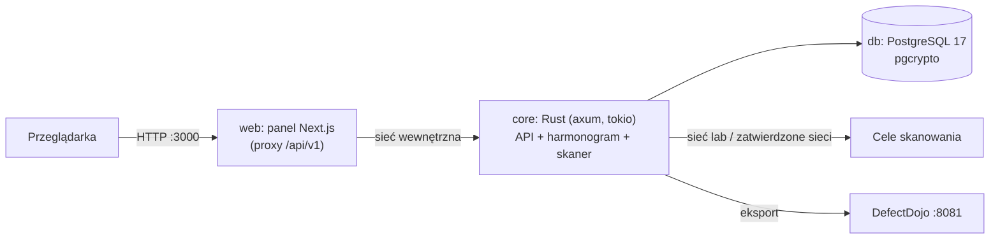

# Attack Surface Intelligence — dokumentacja techniczna

> Dla administratorów, którzy wdrażają i utrzymują ASI, oraz dla programistów, którzy go rozwijają.
> Stan na 22 listopada 2026 r. (gałąź `main`). Źródłem prawdy jest kod; co działa, a co nie — w
> [STATUS.md](STATUS.md). Pytania klientów — w [FAQ](FAQ.md).

## Spis treści

1. [Przegląd](#1-przegląd)
2. [Architektura](#2-architektura)
3. [Mapa kodu](#3-mapa-kodu)
4. [Potok skanowania](#4-potok-skanowania)
5. [Wykrywanie zmian](#5-wykrywanie-zmian)
6. [Znaleziska, priorytet i sygnatury](#6-znaleziska-priorytet-i-sygnatury)
7. [Model danych](#7-model-danych)
8. [Bezpieczeństwo](#8-bezpieczeństwo)
9. [Uruchomienie](#9-uruchomienie)
10. [Konfiguracja](#10-konfiguracja)
11. [Utrzymanie](#11-utrzymanie)
12. [API](#12-api)
13. [Panel (frontend)](#13-panel-frontend)
14. [Testy i pomiary](#14-testy-i-pomiary)
15. [Rozwiązywanie problemów](#15-rozwiązywanie-problemów)
16. [Znane ograniczenia](#16-znane-ograniczenia)
17. [Powiązane dokumenty](#17-powiązane-dokumenty)

---

## 1. Przegląd

ASI to system cyklicznego, ograniczonego co do tempa skanowania dużych sieci (ponad 10 000 adresów IP)
z wykrywaniem zmian w czasie. Po każdym przebiegu porównuje wynik z poprzednim i nadaje znaleziskom
priorytet, a analityk pracuje w panelu WWW w języku polskim.

Zasady, na których opiera się projekt:

1. **Bezpieczeństwo skanowania ważniejsze niż kompletność.** Tylko zatwierdzony zakres, limity tempa,
   okna czasowe; żadnych logowań, zgadywania haseł ani wykorzystywania podatności.
2. **Porównujemy tylko to, co porównywalne.** Adres, którego nie zmierzono, nie „znika”.
3. **Dowody są niezmienne, adnotacje leżą obok.** Edycje analityka nie nadpisują danych ze skanu
   i przetrwają kolejne przebiegi.
4. **Wszystko jest audytowane.** Każda zmiana i każda odmowa dostępu trafia do dziennika.

---

## 2. Architektura



Wszystko uruchamia jeden plik `compose.yaml`:

| Usługa | Obraz | Rola | Sieci |
|---|---|---|---|
| `web` | `frontend/Dockerfile` (Next.js 16) | panel; przekazuje `/api/v1/*` do rdzenia (tryb `proxy`) | `default` (wewnętrzna, stały adres `10.231.70.250`), `edge` (jedyny port publiczny 3000) |
| `core` | `core/Dockerfile` (Rust + nmap + naabu + httpx) | API, harmonogram, uruchamianie skanerów, diff, sygnatury, eksport | `default`, `lab` — obie wewnętrzne, bez wyjścia do internetu |
| `db` | `postgres:17-alpine` | dane, historia, zaszyfrowane pola | `default` |
| `dojo-*` | DefectDojo 3.4.304 | lokalna instancja DefectDojo; UI na `localhost:8081` | własna `dojo` + `default` + `edge` (tylko nginx) |
| `dojo-connect` | `python:3.13-alpine` | jednorazowo: pobiera token DefectDojo i zapisuje integrację w ASI (pomija, jeśli już skonfigurowana) | `default` |
| `lab-*` | nginx, httpd | laboratorium `172.30.0.0/24`: `.10` www, `.11` intranet, `.13` blog (CMS do sygnatur); `.12` admin — profil `lab2` | `lab` |
| `tl-*` | WordPress, MariaDB, phpMyAdmin, Redis, FTP, DVWA, Gitea… | duże laboratorium TestLab (profil `testlab`), adresy `172.30.0.20–.44` | `lab` |

Rdzeń to jeden proces: API nie wykonuje skanu w trakcie zapytania HTTP — tylko tworzy przebieg, który
harmonogram uruchamia w tle. Kontener `core` działa bez roota, bez capabilities (`cap_drop: ALL`)
i z `no-new-privileges`.

---

## 3. Mapa kodu

### Rdzeń (`core/src`)

| Plik | Odpowiedzialność |
|---|---|
| `main.rs` | start usługi: konfiguracja, migracje, administrator startowy, harmonogram, serwer HTTP |
| `config.rs` | konfiguracja ze zmiennych środowiskowych (sekrety także z plików `*_FILE`), polityka zakresu (sieci, domeny, porty, wykluczenia), zaufane proxy |
| `auth.rs` | hasła Argon2id, sesje, CSRF, limit logowań, prawdziwy adres klienta za proxy, middleware `gate`, administrator startowy |
| `rbac.rs` | 4 role wbudowane, 41 uprawnień, tabela „trasa → uprawnienie” |
| `audit.rs` | dziennik zdarzeń (tylko dopisywanie) |
| `keyring.rs` | rotacja klucza szyfrowania: lista wszystkich zaszyfrowanych kolumn, ponowne szyfrowanie partiami |
| `input.rs` | normalizacja i walidacja celów (IP, CIDR, domeny), odejmowanie wykluczeń, podział na podgrupy |
| `scheduler.rs` | co 5 s: wznawia wstrzymane przebiegi, gdy otwiera się okno, uruchamia zaplanowane skany |
| `pipeline.rs` | wykonanie przebiegu podgrupa po podgrupie, przypięte rozwiązywanie nazw, adaptacyjny rozmiar podgrup, okna, punkty kontrolne |
| `engine.rs` | uruchamianie narzędzi jako podprocesów, limity czasu, plik STOP |
| `parse.rs` | parsery wyjścia nmap (XML) oraz naabu i httpx (JSON lines) |
| `fingerprint.rs` | prosta klasyfikacja: CMS, panele administracyjne, środowiska testowe; przechowywane nagłówki z ukrytymi sekretami |
| `signatures.rs` | sygnatury (JSON), ich ewaluacja na zebranych danych, próby ścieżek, test, import/eksport |
| `history.rs` | po przebiegu: ponowne sprawdzenie zniknięć, historia hostów, statusy unstable/inactive |
| `presence.rs` | obecność zależna od pory dnia, pokrycie adresów przez przebiegi |
| `diff.rs` | porównanie dwóch przebiegów (czysta funkcja) |
| `api.rs` | router HTTP (`/api/health` i `/api/v1/*`) |
| `v1.rs`, `v1_scans.rs`, `v1_assets.rs`, `v1_admin.rs` | API panelu `/api/v1/*` (kontrakt z `frontend/src/lib/api/types.ts`) |

Pozostałe katalogi: `core/migrations` (16 migracji SQL, uruchamiane automatycznie przy starcie),
`core/signatures/builtin.json` (29 sygnatur wbudowanych), `core/fixtures` (prawdziwe wyjścia skanerów do testów).

### Panel (`frontend/src`)

| Katalog | Zawartość |
|---|---|
| `app/` | strony (App Router): `(app)/…` po zalogowaniu, `login`, `dostepnosc`, `pomoc`, proxy `api/v1/[...path]` |
| `features/` | widoki sekcji: pulpit, znaleziska, zmiany, zasoby, skanowania, zakresy, sygnatury, administracja, pomoc |
| `components/` | układ (menu, nagłówek strony), komponenty UI, tabele, wizualizacje (mapa adresów, oś zmian, heatmapa) |
| `lib/` | kontrakt API (`api/types.ts`), uprawnienia, polskie etykiety, formatowanie, preferencje wyglądu |
| `mock/` | wbudowany mock API z danymi demonstracyjnymi i RBAC |

`frontend/client-ip.mjs` — ładowany przed serwerem Next.js; podstawia adres klienta z gniazda TCP do
`X-Forwarded-For`, żeby rdzeń widział prawdziwy adres (§8.1).

### Inne

`scripts/e2e/` (testy całościowe przez panel: API, role, zakres, „Teraz”, scenariusz laboratorium, sygnatury
i domeny, DefectDojo), `scripts/bench/` (benchmark), `scripts/defectdojo/setup.py` (ręczne ponowne
podłączenie DefectDojo), `tools/` (instalator narzędzi ProjectDiscovery z weryfikacją SHA-256,
`versions.json`), `deploy/` (Caddyfile, katalog `control/` na plik STOP, konfiguracja Traefika dla TestLab,
`SECURITY.md`).

---

## 4. Potok skanowania

### 4.1 Od celu do przebiegu

1. Użytkownik dodaje **zakresy** (IP, CIDR do /12, domena) — ręcznie lub z CSV/JSON — i może je grupować tagami.
2. Tworzy **skan**: cele (filtr po tagach, typie i tekście) + profil + termin („Teraz” albo „W najbliższym
   oknie”) + okno godzinowe. Przed startem `POST /api/v1/scans/estimate` zwraca liczbę adresów, podział na
   podgrupy i szacowany czas. Zakończony skan można powtórzyć przyciskiem „Skanuj ponownie”.
3. **Polityka zakresu** sprawdza każdy cel i port:
   - IPv4 tylko z `ASI_ALLOWED_CIDRS`; domeny tylko z `ASI_ALLOWED_DOMAINS` (wraz z poddomenami), i tylko gdy
     wszystkie ich adresy IPv4 należą do `ASI_ALLOWED_CIDRS`;
   - nigdy 0.0.0.0/8, 127.0.0.0/8, 169.254.0.0/16, 224.0.0.0/4, 240.0.0.0/4;
   - porty tylko z `ASI_ALLOWED_PORTS` (presety top-N są zawężane do zatwierdzonych portów);
   - cele oznaczone jako wykluczone i `ASI_EXCLUDED_CIDRS` są **odejmowane** od zakresów przed podziałem na
     podgrupy (np. /28 bez jednego adresu = 13 adresów); lista jest zamrażana w `target_snapshot.except`.

   Naruszenie — odmowa (403/422) z czytelnym komunikatem i wpisem w dzienniku.
4. **Harmonogram** (`scheduler.rs`) uruchamia przebieg; równocześnie działa najwyżej `ASI_MAX_RUNS` przebiegów,
   a limit `ASI_GLOBAL_PPS` jest dzielony między nie.

### 4.2 Etapy jednej podgrupy (`pipeline.rs`)

Przed etapami rdzeń sam rozwiązuje każdą domenę i sprawdza adresy z polityką zakresu. Narzędzia dostają
**wyłącznie sprawdzone adresy IP** (ochrona przed DNS rebinding); nazwa trafia do httpx jako nagłówek `Host`
i SNI.

| Etap | Narzędzie | Najważniejsze parametry |
|---|---|---|
| 1. Pre-flight | `nmap -sn` | `-n -T4 --max-retries 0 -PS<porty profilu> --max-rate <limit>` — wykrywa żywe hosty |
| 2. Porty | `naabu` | skan CONNECT (`-s c`), `-Pn`, `-rate <limit>`, `-retries 1`, `-duc` (bez sprawdzania aktualizacji) |
| 3. Usługi | `nmap` | `-sT -sV --version-light -Pn -n --host-timeout 90s` tylko na otwartych portach; skrypty NSE kategorii „version” usunięte z obrazu |
| 4. WWW | `httpx` | tylko porty HTTP/TLS lub nierozpoznane; tytuł, kod, nagłówki, TLS, przekierowania (zapisywane, **nigdy nie śledzone**), favicon, technologie, pierwsze 32 KiB treści; jawny `User-Agent`, `-timeout 5`, `-retries 1` |
| 4b. Próby ścieżek | `httpx -path` | tylko ścieżki z włączonych sygnatur typu `path` (≤ 16, np. `/.git/HEAD`, `/login`, `/admin/`, `/version`); jedno zapytanie GET na ścieżkę, bez logowania i bez przekierowań; zapisywane 16 KiB odpowiedzi |
| 5. Zapis | PostgreSQL | obserwacje; wrażliwe pola szyfrowane |

Po ostatniej podgrupie: ponowne sprawdzenie zniknięć i diff (`history.rs`, `diff.rs`), ewaluacja sygnatur
(`signatures.rs`), automatyczny eksport nowych znalezisk do DefectDojo (jeśli włączony).

### 4.3 Podgrupy, okna i punkty kontrolne

- **Adaptacyjny rozmiar podgrup:** rozmiar kolejnej podgrupy wynika ze zmierzonej szybkości poprzedniej,
  tak aby trwała ok. 120 s (albo połowę pozostałego okna), z górnym limitem `batch_size` skanu. Profil
  „Duża sieć” używa stałych podgrup /22.
- **Okna:** godziny, strefa czasowa i dni tygodnia. Limity czasu narzędzi są przycinane do końca okna.
  Po zamknięciu okna przebieg przechodzi w `paused_window` i wznawia się od ostatniej ukończonej podgrupy
  (albo kończy, jeśli `on_window_exceeded = "stop"`). „Teraz” startuje od razu, także poza oknem.
- **Harmonogramy:** codziennie albo w wybrane dni tygodnia (cron nie jest obsługiwany).
- **Odporność:** maksymalny czas jednego narzędzia — 30 min; przebiegi przerwane restartem są odtwarzane.

### 4.4 Profile wbudowane

| Profil | Porty | Tempo | Zastosowanie |
|---|---|---:|---|
| Laboratorium | zatwierdzone (`ASI_ALLOWED_PORTS`) | 100/s | laboratorium, pierwszy skan |
| Duża sieć | zatwierdzone | 1000/s | sieci od 10 000 adresów (podgrupy /22) |
| Szybki | top-100 ∩ zatwierdzone | 100/s | codzienny przegląd |
| Standardowy | top-1000 ∩ zatwierdzone | 200/s | pełniejszy obraz usług (domyślny w kreatorze) |
| Delikatny | top-100 ∩ zatwierdzone | 20/s, `-T2` | drukarki, IoT, sieci wrażliwe |

Własne profile tworzy się w „Skanowania → Profile”; `rate_limit_rps` nie może przekroczyć limitu globalnego.

### 4.5 Skan SYN (eksperymentalny)

`compose.syn.yaml` włącza `ASI_SYN_SCAN=1`: odkrywanie portów przez półotwarte połączenia osobną kopią
naabu (`naabu-raw`) z `cap_net_raw`. W pierwszym pomiarze pominął otwarte porty u 17 z 66 hostów —
domyślnie wyłączony.

---

## 5. Wykrywanie zmian

Diff porównuje **dwa przebiegi tych samych celów** (`diff.rs`):

| Typ | Znaczenie |
|---|---|
| `new` | host, usługa lub strona pojawiła się |
| `changed` | inny produkt/wersja usługi, inny tytuł/kod/serwer strony |
| `gone` | przestało odpowiadać (dla hosta — po progu nieobecności) |
| `unstable` | host nie odpowiedział, ale nie przekroczył progu |

Reguły:

- **Ponowne sprawdzenie:** to, co zniknęło, jest skanowane raz jeszcze po 10 s, zanim zostanie zgłoszone.
- **unstable → inactive:** brakujący host jest przenoszony do kolejnych przebiegów jako `unstable` i staje się
  `inactive` po `inactive_after_misses` kolejnych nieobecnościach (domyślnie 3, zakres 1–100). Powroty
  liczone są jako „mignięcia” (flaps).
- **Pora dnia** (`presence.rs`): z historii przebiegów (strefa Europe/Warsaw) ASI wyznacza godziny, w których
  host odpowiada. Wzorzec „Widoczny tylko 08–18” (albo „Niewidoczny 22–06”) jest zgłaszany, gdy host
  odpowiedział w ≥ 2 przebiegach w tych godzinach (≥ 75%), milczał w ≥ 2 poza nimi i cykl się powtórzył.
  Widać go w „Zmiany → Hosty niestabilne” z uzasadnieniem.
- **Pewność:** pewność identyfikacji × stabilność, gdzie stabilność = 1 / (1 + mignięcia); dla zniknięcia —
  nieobecności / próg.
- **Waga (interest 1–3):** ranking „najważniejszych zmian”; usługi wrażliwe (np. 21, 23, 445, 3306, 3389,
  5432, 6379, 9200, 27017) dostają wyższą wagę.
- **Pokrycie:** adresy nieporównywalne (cel dodany/usunięty, podgrupa nieudana, adres wykluczony) są pomijane.
- Usługi i strony hosta, który zniknął, nie są raportowane osobno — wystarczy wpis hosta.

---

## 6. Znaleziska, priorytet i sygnatury

### 6.1 Skąd biorą się znaleziska

| Kategoria | Źródło | Punkty bazowe |
|---|---|---:|
| Panel administracyjny | tytuł/adres strony (`fingerprint.rs`) | 60 |
| Usługa wrażliwa dostępna z sieci | otwarty port z listy wrażliwych (bazy danych, RDP, SMB, Telnet, Docker API…) | 50 |
| Środowisko testowe | etykieta nazwy hosta (staging, test, dev…; bez domeny najwyższego poziomu, więc `*.test` się nie liczy), tytuł | 45 |
| Dopasowanie sygnatury | sygnatura wbudowana lub własna | 30 + waga sygnatury (maks. 80) |

**Jedno znalezisko na problem:** tożsamość znaleziska to kategoria + host/usługa/URL (dla sygnatur: sygnatura +
usługa), a nie numer skanu. Lista pokazuje jedno znalezisko z ostatniej obserwacji, z `first_seen`, `last_seen`
i liczbą skanów (`occurrences`). Jeśli nowszy skan, który objął ten adres i port, już go nie widzi, znalezisko
ma `change = "gone"` i nie trafia do „najważniejszych”, liczników otwartych ani do eksportu.

### 6.2 Priorytet (0–100)

`priorytet = punkty bazowe + 20 (jeśli nowe od poprzedniego skanu) + krytyczność zakresu (low 0, medium 5,
high 10, critical 20) − 10 (jeśli pewność identyfikacji < 0,6)`, przycięty do 0–100. Rozbicie jest
zwracane w `score_breakdown` i pokazywane w panelu; analityk może ustawić `score_override`.

Mapowanie na severity DefectDojo: ≥ 80 High, ≥ 60 Medium, ≥ 40 Low, poniżej Info.

### 6.3 Status znaleziska

`open` (Do analizy), `in_review` (W analizie), `confirmed` (Potwierdzone), `false_positive` (Fałszywy alarm),
`accepted` (Zaakceptowane ryzyko). Status, osoba przypisana, tagi, notatki i znacznik eksportu do DefectDojo
są w `finding_states` (jeden wiersz na znalezisko) i przetrwają kolejne skany.

### 6.4 Sygnatury

Deklaratywne reguły JSON. Większość warunków ocenia dane **już zebrane** przez skaner; warunek `path` to
jedno bezpieczne zapytanie GET o wskazaną ścieżkę. Przykład (wbudowana sygnatura phpMyAdmin):

```json
{
  "name": "phpMyAdmin",
  "category": "admin_panel",
  "technology": "phpMyAdmin",
  "score_weight": 25,
  "match": {
    "operator": "or",
    "conditions": [
      { "type": "title", "op": "regex", "value": "^phpMyAdmin" },
      { "type": "cookie", "name": "phpMyAdmin", "op": "exists" }
    ]
  }
}
```

| Typ warunku | Co sprawdza |
|---|---|
| `header` | dowolny nagłówek odpowiedzi (przechowywane są wszystkie; wartości „sekretnych” nagłówków ukryte) |
| `cookie` | nazwa ciasteczka |
| `title`, `status` | tytuł strony, kod odpowiedzi |
| `favicon_hash` | skrót favicon (mmh3) |
| `html` | fragment HTML w pierwszych 32 KiB strony (np. `meta generator`, wersja w stopce) |
| `version` | produkt/wersja usługi z nmap |
| `path` | bezpieczne GET o ścieżkę (absolutna, ≤ 200 znaków, bez `..`, `?`, `#`, `@`); domyślnie oczekiwany kod 2xx albo `expect_status`; opcjonalnie warunek na treść |

Operatory: `exists`, `equals`, `contains`, `regex`; `extract` wyciąga wersję (np. „WordPress 6.4.2”).
Wbudowanych sygnatur jest 29 (m.in. phpMyAdmin, Grafana, Kibana, Jenkins, GitLab, Portainer, Tomcat Manager,
kamery Hikvision/Dahua, MikroTik, iDRAC/iLO, drukarki HP, listing katalogu, repozytorium `.git` dostępne
z sieci, strona logowania, panel `/admin/`, endpoint `/version`, wersja w stopce, meta generator CMS).
Przed zapisaniem sygnaturę można przetestować na zebranych danych usługi albo na surowej odpowiedzi;
import i eksport — JSON.

---

## 7. Model danych

PostgreSQL 17, schemat tworzony przez migracje `core/migrations/0001…0016` (uruchamiane przy starcie rdzenia).

| Obszar | Tabele |
|---|---|
| Cele | `targets` (z tagami i flagą wykluczenia) |
| Skany | `scans` (konfiguracja, okno, harmonogram), `scan_targets`, `scan_profiles`, `scan_runs` (przebiegi, statystyki, punkty kontrolne, `target_snapshot`), `run_artifacts` (surowe wyjścia narzędzi) |
| Obserwacje | `hosts`, `services`, `http_findings`, `http_probes` (wyniki prób ścieżek) |
| Sygnatury | `signatures` (reguły własne), `signature_hits` (dopasowania z dowodami) |
| Zmiany | `diffs` |
| Praca analityka | `annotations`, `annotation_history`, `asset_overrides`, `finding_states` |
| Dostęp | `users`, `sessions`, `custom_roles`, `audit_log` |
| Integracje | `settings` (m.in. konfiguracja DefectDojo), `defectdojo_exports` |

**Pola szyfrowane** (`pgp_sym_encrypt` kluczem `ASI_DATA_KEY`, 16 kolumn — pełna lista w `keyring.rs`):
`services.banner_enc`, `http_findings.headers_enc / cookies_enc / tls_enc / raw_enc / body_enc`,
`http_probes.body_enc`, `signature_hits.evidence_enc`, `run_artifacts.content_enc`, `diffs.old_enc / new_enc`,
`annotations.notes_enc`, `annotation_history.notes_enc`, `targets.notes_enc`, `finding_states.notes_enc`,
`settings.secret_enc` (token DefectDojo). Odczyt idzie przez funkcję `asi_decrypt`, która w czasie rotacji
próbuje też poprzedniego klucza. Klucz nigdy nie jest zapisywany w bazie.

Adnotacje są przypięte do stabilnych kluczy, których używa diff: host → IP, usługa → `ip:port/proto`,
strona → URL. Dzięki temu przetrwają kolejne skany.

---

## 8. Bezpieczeństwo

### 8.1 Uwierzytelnianie i sesje

- Hasła: Argon2id, 12–256 znaków. Nieznane loginy są sprawdzane względem fikcyjnego skrótu, więc czas
  odpowiedzi nie zdradza, które konta istnieją.
- Sesje: 32 losowe bajty (base64url); baza trzyma tylko SHA-256. Przyjmowane jako `Authorization: Bearer`
  albo ciasteczko `asi_session` (HttpOnly, SameSite=Strict, `Path=/api`, `Secure` przy
  `ASI_COOKIE_SECURE=true`). Czas życia: `ASI_SESSION_TTL_HOURS` (domyślnie 12 h).
- CSRF: zapytania zmieniające dane z ciasteczkiem wymagają nagłówka `X-ASI-CSRF: 1` i dozwolonego `Origin`
  (`ASI_ALLOWED_ORIGINS`).
- **Prawdziwy adres klienta:** panel podstawia adres z gniazda TCP do `X-Forwarded-For`
  (`frontend/client-ip.mjs`), a rdzeń ufa temu nagłówkowi tylko od adresów z `ASI_TRUSTED_PROXIES`
  (w Compose — sam panel, `10.231.70.250`). Każdy inny nadawca jest klientem, niezależnie od nagłówków.
- Limit logowań: 5 nieudanych prób na login albo 20 na adres IP klienta w 15 min → 429.
- Zmiana roli lub hasła unieważnia sesje użytkownika.

### 8.2 Autoryzacja (RBAC)

Jeden middleware (`auth::gate`) obejmuje każdą trasę: domyślnie odmowa, prawo z tabeli `rbac::ROUTES`
i `rbac::V1_PERMS`. Role wbudowane:

| Rola (API) | Nazwa w panelu | Zakres |
|---|---|---|
| `admin` | Administrator | wszystko, w tym użytkownicy, role, integracje, ustawienia |
| `editor` | Operator | odczyt, dowody, tworzenie, edycja, usuwanie |
| `modifier` | Analityk | odczyt, dowody, edycja (bez tworzenia i usuwania) |
| `viewer` | Obserwator | tylko odczyt |

Uruchamianie skanów to osobne prawo użytkownika (`can_execute_scans`) — ma znaczenie dla Operatora
i Analityka; Administrator ma je zawsze, Obserwator nigdy. **Role własne** składa się z 41 uprawnień
(np. `targets:create`, `scans:control`, `findings:defectdojo`, `sensitive:reveal`, `audit:read`);
rolę administratora może nadać tylko administrator, a zmiana uprawnień roli działa od razu.

### 8.3 Dziennik zdarzeń

`audit_log` — tylko dopisywanie. Wpis dla każdej zmiany i każdej odmowy (401/403): kto, akcja, obiekt,
adres IP klienta, wynik. Bez haseł, tokenów, kluczy i treści zapytań.

### 8.4 Bezpieczeństwo skanowania

- Polityka zakresu (§4.1) po stronie serwera; użytkownik panelu nie może jej obejść. Każdy adres jest
  sprawdzany ponownie tuż przed przekazaniem narzędziu.
- **DNS rebinding:** nazwy są rozwiązywane raz, przez rdzeń, przy szacowaniu i przed każdą podgrupą; narzędzia
  dostają tylko sprawdzone adresy, a wynik spoza podgrupy przerywa ją.
- **Przekierowania:** nigdy nie są śledzone (jeden budowniczy argumentów httpx, test pilnuje braku `-fr`);
  adres docelowy jest tylko zapisywany.
- Wspólny limit `ASI_GLOBAL_PPS` dla wszystkich przebiegów. To limit przekazywany narzędziom, a nie
  egzekwowanie na poziomie pakietów — w teście z limitem 8/s odnotowano chwilowo do 14 pakietów IPv4.
  Twardy limit wymaga reguł tc/nftables na hoście lub zapory (kontener nie ma `NET_ADMIN`).
- Plik STOP (`deploy/control/STOP`, w kontenerze `ASI_STOP_FILE`): przerywa trwające narzędzia i blokuje
  nowe przebiegi, dopóki istnieje.
- Rdzeń i baza bez wyjścia do internetu; narzędzia z `-duc`; jawny `User-Agent`
  (`ASI/0.1 (Attack Surface Intelligence; authorised scan)`, zmienny w ustawieniach).
- Dane wejściowe użytkownika nie trafiają do linii poleceń: cele są przekazywane plikiem, porty walidowane.
- Narzędzia ProjectDiscovery (naabu, httpx) mają przypięte wersje i sumy SHA-256 sprawdzane przy budowie obrazu.

### 8.5 Wdrożenie produkcyjne

`compose.production.yaml` to samodzielny wzorzec: obrazy przypięte skrótem (`…@sha256:`), sekrety z plików
(`*_FILE`), kontenery `read_only` bez capabilities, sieci wewnętrzne o stałych podsieciach, jedyny port
publiczny — 443 na serwerze Caddy z TLS i nagłówkami bezpieczeństwa (HSTS, CSP, `nosniff`, `no-referrer`).
Caddy przekazuje adres klienta, panel ufa tylko Caddy, rdzeń — tylko panelowi. Rdzeń działa w trybie
inwentaryzacji (`ASI_MAX_RUNS=0`) — skanowanie wykonuje osobny, kontrolowany węzeł. Otwarte punkty odbioru
(testy ruchu na poziomie pakietów) — w [deploy/SECURITY.md](../deploy/SECURITY.md).

---

## 9. Uruchomienie

### 9.1 Wymagania

Docker Desktop (Windows/macOS) albo Docker Engine z Compose (Linux), ok. 6 GB RAM (z DefectDojo; TestLab —
dodatkowo kilka GB obrazów), Python 3 do skryptów pomocniczych. Pierwsza budowa: 5–10 min.

### 9.2 Plik `.env`

Repozytorium zawiera wspólny `.env` zespołu (hasła i klucze stanowiska laboratoryjnego) — wystarczy go użyć.
Na własnym serwerze utwórz nowy `.env` z `.env.example` i wygeneruj sekrety (PowerShell):

```powershell
Copy-Item .env.example .env
function New-Secret($n) { $b = New-Object byte[] $n; [Security.Cryptography.RandomNumberGenerator]::Create().GetBytes($b); [Convert]::ToBase64String($b) }
function New-Hex($n) { $b = New-Object byte[] $n; [Security.Cryptography.RandomNumberGenerator]::Create().GetBytes($b); -join ($b | ForEach-Object { '{0:x2}' -f $_ }) }
(Get-Content .env) -replace '^ASI_DATA_KEY=.*', "ASI_DATA_KEY=$(New-Secret 32)" -replace '^ASI_ADMIN_PASSWORD=.*', "ASI_ADMIN_PASSWORD=$(New-Secret 18)" `
  -replace '^DD_SECRET_KEY=.*', "DD_SECRET_KEY=$(New-Hex 32)" -replace '^DD_CREDENTIAL_AES_256_KEY=.*', "DD_CREDENTIAL_AES_256_KEY=$(New-Hex 16)" `
  -replace '^DD_DATABASE_PASSWORD=.*', "DD_DATABASE_PASSWORD=$(New-Hex 16)" -replace '^DD_ADMIN_PASSWORD=.*', "DD_ADMIN_PASSWORD=$(New-Hex 12)" | Set-Content .env -Encoding ascii
```

Na Linuksie to samo przez `openssl rand -base64 32` / `openssl rand -hex 16` (polecenia w README).
Wymagane: `ASI_DATA_KEY`, `POSTGRES_PASSWORD`, `ASI_ADMIN_PASSWORD` (12–256 znaków), `DD_SECRET_KEY`,
`DD_CREDENTIAL_AES_256_KEY` (32 znaki), `DD_DATABASE_PASSWORD`, `DD_ADMIN_PASSWORD`.

Uwaga: w wartościach w `.env` unikaj znaku `$` (Compose traktuje go jako zmienną), a w
`DD_DATABASE_PASSWORD` — znaków `@ : / ? #` (hasło trafia do adresu URL bazy).

### 9.3 Start

```bash
docker compose up -d --build
```

Jedno polecenie uruchamia bazę, rdzeń, panel, DefectDojo i laboratorium. Przy pierwszym starcie DefectDojo
wykonuje migracje (2–3 min), po czym `dojo-connect` sam podłącza ASI (produkt „ASI — CBI AGH”, engagement
„ASI — skanowanie ciągłe”, automatyczny eksport od priorytetu 60). Jeśli Docker Hub odpowiada
`429 Too Many Requests`: `ASI_BASE_REGISTRY=mirror.gcr.io/library docker compose up -d --build`.

| Co | Adres | Login | Hasło |
|---|---|---|---|
| Panel ASI | http://localhost:3000 | `admin` | `ASI_ADMIN_PASSWORD` |
| DefectDojo | http://localhost:8081 | `admin` | `DD_ADMIN_PASSWORD` |

### 9.4 Laboratorium i scenariusz zmian

Laboratorium to izolowana sieć `172.30.0.0/24`: nginx (`.10`, `www.asi.test`), Apache (`.11`,
`intranet.asi.test`), strona CMS (`.13`, `blog.asi.test` — meta generator, wersja w stopce, `X-Powered-By`,
odsłonięte `/.git/HEAD`, `/version`, `/login`, `/admin/`). Pierwszy skan: zakres `172.30.0.0/28`, profil
„Laboratorium”, „Teraz” (ok. 15 s). Scenariusz zmian: `docker compose stop lab-httpd` i
`docker compose --profile lab2 up -d lab-admin` (nowy host `.12` z panelem logowania na stagingu), potem
drugi skan — w „Zmianach” widać nowy host i zniknięcie Apache. Powrót: `docker compose start lab-httpd`,
`docker compose --profile lab2 stop lab-admin`.

**TestLab** (`docker compose --profile testlab up -d`): WordPress 6 (`.20`, `wp.asi.test`) i 4.7
(`.30`, `old.asi.test`, instalowane automatycznie), MariaDB, phpMyAdmin, Redis, Nginx Proxy Manager,
Traefik + Toxiproxy, MySQL 5.7, Adminer, FTP, DVWA, httpbin, PostgreSQL, RabbitMQ, Gitea — adresy
`172.30.0.20–.44`, bez portów na hoście. Porty 21, 81, 3000, 5672, 8474, 8666, 15672 są skanowane dopiero po
odkomentowaniu linii TestLab w `.env` (z `.env.example`).

Zatrzymanie: `docker compose --profile testlab --profile lab2 down` (dane zostają w wolumenach).

### 9.5 Dostęp skryptów do API

Testy `scripts/e2e/` chodzą przez panel (jak przeglądarka) i nie potrzebują nic więcej:

```bash
python -I -X utf8 scripts/e2e/api_check.py .env
```

Bezpośredni dostęp do API rdzenia na `127.0.0.1:8000` (tylko do pracy deweloperskiej — nakładka daje
rdzeniowi też wyjście do sieci): `docker compose -f compose.yaml -f compose.api.yaml up -d`.

### 9.6 Rozwój

```bash
docker compose up -d db                 # sama baza
cd core && cargo test                   # testy rdzenia
cd frontend && npm ci && npm run dev    # panel na danych demonstracyjnych (ASI_API_MODE=mock)
```

---

## 10. Konfiguracja

### 10.1 Rdzeń (`core`)

Zmienne oznaczone `*_FILE` można podać jako ścieżkę do pliku z sekretem (np. `ASI_DATA_KEY_FILE`).

| Zmienna | Domyślnie | Opis |
|---|---|---|
| `DATABASE_URL` (`_FILE`) | składana z `POSTGRES_PASSWORD` | adres PostgreSQL |
| `ASI_DATA_KEY` (`_FILE`) | — (wymagana) | klucz szyfrowania pól (`pgcrypto`) |
| `ASI_DATA_KEY_PREVIOUS` (`_FILE`) | pusta | poprzedni klucz — tylko na czas rotacji (§11.4) |
| `ASI_ADMIN_USER` | `admin` | login administratora startowego |
| `ASI_ADMIN_PASSWORD` (`_FILE`) | — | hasło administratora startowego, 12–256 znaków; używane tylko bez aktywnego administratora |
| `ASI_SESSION_TTL_HOURS` | `12` | czas życia sesji, 1–720 h |
| `ASI_COOKIE_SECURE` | `false` | flaga `Secure` ciasteczka (HTTPS) |
| `ASI_ALLOWED_ORIGINS` | `http://localhost:3000,…:3001,http://127.0.0.1:3000,…:3001` | dozwolone `Origin` dla zapytań zmieniających dane |
| `ASI_TRUSTED_PROXIES` | w Compose `10.231.70.250` (panel) | adresy/CIDR, którym rdzeń wierzy w `X-Forwarded-For` |
| `ASI_ALLOWED_CIDRS` | `172.30.0.0/24` | sieci IPv4, które wolno skanować |
| `ASI_ALLOWED_DOMAINS` | `asi.test` | domeny (z poddomenami), które wolno skanować; muszą wskazywać na `ASI_ALLOWED_CIDRS` |
| `ASI_DNS_RESOLVERS` | z `/etc/resolv.conf` kontenera | serwery DNS rdzenia |
| `ASI_ALLOWED_PORTS` | `22,80,443,3306,5432,6379,8080,8443` | porty, które wolno skanować |
| `ASI_EXCLUDED_CIDRS` | pusta | wykluczenia (ważniejsze niż zgody, odejmowane od zakresów) |
| `ASI_GLOBAL_PPS` | `1000` | wspólny limit zapytań/s wszystkich przebiegów |
| `ASI_MAX_RUNS` | `1` | równoczesne przebiegi; `0` — tylko API, bez skanowania |
| `ASI_MAX_CONCURRENCY` | `256` | wątki dla naabu/httpx (ograniczane do 100) |
| `ASI_STOP_FILE` | `/run/asi-control/STOP` | plik awaryjnego zatrzymania (w Compose montowany z `deploy/control`) |
| `ASI_BIND` | `0.0.0.0:8000` | adres nasłuchu API |
| `ASI_TOOLS_DIR` | `/opt/asi-tools` | katalog narzędzi |
| `ASI_SYN_SCAN` | wyłączone | skan SYN; wymaga `compose.syn.yaml` |
| `DEFECTDOJO_URL`, `DEFECTDOJO_TOKEN` (`_FILE`) | puste | inna instancja DefectDojo niż lokalna; ustawienia zapisane w panelu mają pierwszeństwo |
| `DEFECTDOJO_PUBLIC_URL` | `http://localhost:8081` | adres DefectDojo w linkach panelu |

### 10.2 Panel (`web`)

| Zmienna | Domyślnie | Opis |
|---|---|---|
| `ASI_API_MODE` | `proxy` w Dockerze, `mock` w `npm run dev` | `proxy` — rdzeń, `mock` — dane demonstracyjne, `hybrid` — rdzeń + mock dla brakujących tras |
| `ASI_API_URL` | `http://core:8000` | adres rdzenia |
| `ASI_SESSION_COOKIE` | `asi_session` | nazwa ciasteczka sesji sprawdzanego przy wejściu na stronę |
| `ASI_WEB_TRUSTED_PROXIES` | pusta | proxy przed panelem (np. Caddy w produkcji), którym panel wierzy w `X-Forwarded-For` |

### 10.3 Compose

`POSTGRES_PASSWORD` (wymagana), `ASI_WEB_PORT` (3000), `ASI_API_PORT` (8000, z `compose.api.yaml`),
`ASI_BASE_REGISTRY` (`docker.io/library`), dla DefectDojo: `DD_SECRET_KEY`, `DD_CREDENTIAL_AES_256_KEY`
(32 znaki), `DD_DATABASE_PASSWORD`, `DD_ADMIN_PASSWORD`, `DD_VERSION` (3.4.304), `DD_PORT` (8081);
TestLab: `TL_LATENCY_MS` (opóźnienie WordPressa za Toxiproxy, ms). Sieć wewnętrzna `default` ma stałą
podsieć `10.231.70.0/24`. Produkcja: `ASI_PUBLIC_HOST`, repozytoria i skróty obrazów (`*_REPO`, `*_DIGEST`),
ścieżki sekretów (`*_PATH`).

### 10.4 Ustawienia w panelu

„Administracja → Ustawienia” (m.in. `User-Agent` skanera, szyfrowanie i rotacja klucza) i „Administracja →
Integracje” (DefectDojo: adres, token przechowywany w postaci zaszyfrowanej, automatyczny eksport, próg
priorytetu, eksport jako znalezisko lub dowód, weryfikacja TLS). Każda zmiana trafia do dziennika zdarzeń.

---

## 11. Utrzymanie

### 11.1 Kopie zapasowe

```bash
docker compose exec -T db pg_dump -U asi -d asi -Fc > asi-$(date +%F).dump       # kopia
# odtworzenie: najpierw zatrzymaj rdzeń, żeby nic nie pisało do bazy
docker compose stop core
docker compose exec -T db pg_restore -U asi -d asi --clean < asi-YYYY-MM-DD.dump
docker compose start core
```

Klucz `ASI_DATA_KEY` przechowuj osobno, w zaufanym miejscu: kopia bez klucza nie odszyfruje pól wrażliwych,
a klucz bez kopii nic nie daje. Pełna procedura — `deploy/SECURITY.md`.

### 11.2 Hasło administratora z `.env` nie działa (reset)

`ASI_ADMIN_PASSWORD` jest czytane **tylko przy starcie, gdy w bazie nie ma aktywnego administratora**.
Późniejsza zmiana w `.env` nie zmienia hasła istniejącego konta. Aby ustawić hasło z `.env`:

```bash
# 1. wpisz nowe hasło do ASI_ADMIN_PASSWORD w .env (12–256 znaków)
# 2. wyłącz konto i jego sesje
docker exec asi-db-1 psql -U asi -d asi -c "UPDATE sessions SET revoked_at = now() WHERE revoked_at IS NULL AND user_id IN (SELECT id FROM users WHERE username='admin'); UPDATE users SET disabled = true WHERE username='admin';"
# 3. utwórz kontener rdzenia od nowa z bieżącym .env — przy starcie odtworzy konto z hasłem z .env
docker compose up -d --force-recreate core
```

Jeśli w bazie jest kilku administratorów, wyłącz wszystkich albo zmień hasło z konta innego administratora.
Odtworzenie konta trafia do dziennika (`user.bootstrap`).

### 11.3 Awaryjne zatrzymanie

```bash
touch deploy/control/STOP     # przerywa i blokuje skanowanie
rm deploy/control/STOP        # zwalnia blokadę
```

### 11.4 Rotacja klucza szyfrowania

1. Wygeneruj nowy klucz (`openssl rand -base64 32`). Wpisz go do `ASI_DATA_KEY`, a stary przenieś do
   `ASI_DATA_KEY_PREVIOUS`. Uruchom rdzeń ponownie (`docker compose up -d core`).
2. „Administracja → Ustawienia → Szyfrowanie” pokazuje identyfikatory obu kluczy i liczbę wierszy pod starym.
3. Naciśnij „Wykonaj rotację klucza”: wszystkie 16 zaszyfrowanych kolumn jest szyfrowanych ponownie partiami
   po 200 wierszy w transakcjach. Operację można bezpiecznie powtórzyć; trafia do dziennika.
4. Gdy pod starym kluczem zostanie 0 wierszy, usuń `ASI_DATA_KEY_PREVIOUS` i uruchom rdzeń ponownie. Stary
   klucz zachowaj przy kopiach zapasowych, które go potrzebują.

Bez `ASI_DATA_KEY_PREVIOUS` przycisk odpowiada 409 z opisem procedury. Nie zmieniaj samego `ASI_DATA_KEY` bez
tej procedury — zaszyfrowane pola (w tym token DefectDojo) przestaną się odszyfrowywać.

### 11.5 Aktualizacja

```bash
git pull
docker compose up -d --build
```

Migracje bazy uruchamiają się automatycznie przy starcie rdzenia. Dane zostają w wolumenie `asi_db-data`
(`docker compose down` ich nie usuwa; `down -v` — usuwa). Po zmianie sieci w `compose.yaml` wykonaj
`docker compose down` (bez `-v`) i ponownie `up -d`.

### 11.6 Logi i stan

```bash
docker compose ps                     # stan i healthcheck usług
docker compose logs -f core           # rdzeń: start, migracje, przebiegi, eksport
docker compose logs dojo-connect      # podłączenie DefectDojo
```

---

## 12. API

- **Baza:** `/api/v1` (w Dockerze przez panel, np. `http://localhost:3000/api/v1`). Poza tym tylko
  `/api/health`. Pełny kontrakt z przykładami — [API-CONTRACT.md](API-CONTRACT.md).
- **Uwierzytelnianie:** `POST /api/v1/auth/login` z `{"login","password"}` ustawia ciasteczko sesji;
  zapytania zmieniające dane wymagają `X-ASI-CSRF: 1` i dozwolonego `Origin`. `POST /auth/logout`,
  `GET /auth/me`.
- **Błędy:** `{"error": {"code": "...", "message": "..."}}`; walidacja — 422, brak sesji — 401, brak
  uprawnienia — 403, konflikt — 409, limit logowań — 429.
- **Postęp skanu na żywo:** `GET /api/v1/scans/{id}/events` (Server-Sent Events).

| Grupa | Trasy |
|---|---|
| Pulpit i wyszukiwanie | `/dashboard/summary`, `/dashboard/top-findings`, `/dashboard/changes-timeline`, `/dashboard/availability`, `/dashboard/technologies`, `/dashboard/address-map`, `/search`, `/tags` |
| Zakresy | `/targets` (lista z filtrami `q`, `type`, `criticality`, `tag`; dodawanie), `/targets/{id}`, `/targets/bulk`, `/targets/import`, `/targets/export` |
| Skanowania | `/scans`, `/scans/estimate`, `/scans/import`, `/scans/{id}`, `/scans/{id}/{pause\|resume\|cancel}`, `/scans/{id}/batches`, `/scans/{id}/logs`, `/scans/{id}/events`, `/scans/{id}/export`, `/profiles`, `/profiles/{id}`, `/schedules`, `/schedules/{id}` |
| Zasoby i zmiany | `/hosts`, `/hosts/{id}`, `/hosts/{id}/history`, `/hosts/{id}/recheck`, `/hosts/{id}/overrides/{field}`, `/hosts/unstable` (z `time_pattern`), `/services`, `/services/{id}`, `/services/{id}/cookies/{name}/reveal`, `/service-groups`, `/diffs` |
| Znaleziska | `/findings`, `/findings/{id}`, `/findings/export`, `/findings/bulk`, `/findings/defectdojo` |
| Sygnatury | `/signatures`, `/signatures/{id}`, `/signatures/test`, `/signatures/import`, `/signatures/export` |
| Administracja | `/users`, `/users/{id}`, `/roles`, `/roles/{id}`, `/permissions`, `/settings`, `/audit`, `/security/encryption`, `/security/encryption/rotate`, `/engines`, `/integrations/defectdojo` (+ `/test`, `/exports`) |

Formaty plików (cele CSV/JSON, wyniki skanu CSV/JSON/nmap XML, znaleziska CSV/JSON, sygnatury JSON) —
API-CONTRACT.md, §8; przykłady w `frontend/public/samples/`.

---

## 13. Panel (frontend)

- **Stos:** Next.js 16 (App Router), React 19, TypeScript, Tailwind CSS 4, TanStack Query, Radix UI, Recharts.
- **Język:** tylko polski (użytkownicy — polskie instytucje publiczne).
- **Ochrona tras:** `src/proxy.ts` przekierowuje na `/login` bez ciasteczka sesji; właściwą kontrolę robi API.
  Przyciski niedostępne dla roli są ukrywane (`Guard`, `Require`), ale granicą bezpieczeństwa jest serwer.
- **Wygląd i dostępność:** motywy „Wysoki kontrast” (domyślny), „Jasny” i „Ciemny” — tokeny w
  `src/app/globals.css`; rozmiar tekstu A / A+ / A++, ograniczanie animacji, skip-link, obsługa klawiatury,
  deklaracja dostępności (`/dostepnosc`, WCAG 2.1 AA). Wybór użytkownika: `localStorage` (`asi:prefs:v2`).
- **Orientacja:** menu z ikonami, podpowiedziami i grupami (`components/layout/nav.ts` — jedno źródło opisów
  sekcji), opis pod tytułem każdej strony, strona „Pomoc” (`/pomoc`), blok „Jak zacząć” na pulpicie nowej
  instalacji, wyszukiwarka <kbd>Ctrl</kbd> + <kbd>K</kbd>, wskaźnik trwającego skanu w nagłówku.
- **Praca z wieloma celami:** filtry po tagach, typie i tekście w kreatorze skanu („Zaznacz widoczne”) i na
  liście zakresów; kreator ładuje wszystkie cele, nie tylko pierwsze 500.
- **Tryby danych:** `ASI_API_MODE` (§10.2); tryb `mock` pozwala rozwijać panel bez rdzenia.

---

## 14. Testy i pomiary

| Co | Wynik | Gdzie |
|---|---|---|
| Testy rdzenia | 82 zaliczone, 4 wymagające PostgreSQL pominięte w zwykłym przebiegu; `clippy` bez uwag | `cargo test`, `cargo clippy --all-targets` |
| Testy całościowe przez panel | API 68/68, role 25/25, zakres 4/4, „Teraz” 8/8, scenariusz laboratorium 7/7, sygnatury i domeny 17/17, DefectDojo 12/12 | `scripts/e2e/` |
| Panel | `eslint`, `tsc` bez błędów | `npm run lint` |
| Skala | /18 (16 382 adresy, 160 hostów, 8 portów): 1000 zapytań/s — 413 s pracy skanerów (7 min 01 s łącznie); bez limitu — 354 s (6 min 25 s); 160/160 hostów, 140/140 odcisków WWW | [BENCHMARK.md](BENCHMARK.md), `docs/benchmarks/history.csv` |
| Optymalizacja | pre-flight na podgrupę /22: 158 s → 6 s; cały /18: ok. 56 min (prognoza) → ok. 7 min | BENCHMARK.md |
| Hałas u celu | ok. 3 zapytania HTTP na serwer WWW + po jednym GET na ścieżkę włączonych sygnatur `path` (wbudowane: 4); 0 połączeń z internetem | [NOISE.md](NOISE.md) |
| Bezpieczeństwo w laboratorium | zakres, limit, STOP, dostęp, sekrety, produkcja | SECURITY-LAB-2026-11-22.md |
| DefectDojo | 12/12 kontroli na żywo (skan → automatyczny eksport → znaleziska w DefectDojo, bez ponownego importu tych samych problemów) | [DEFECTDOJO.md](DEFECTDOJO.md) |

---

## 15. Rozwiązywanie problemów

| Objaw | Przyczyna | Rozwiązanie |
|---|---|---|
| Hasło z `.env` nie działa, działa stare | administrator startowy jest tworzony tylko raz | §11.2 |
| Rdzeń nie startuje: „no active admin” | brak administratora i brak/za krótkie `ASI_ADMIN_PASSWORD` | ustaw hasło 12–256 znaków |
| `docker compose up`: „set DD_… in .env” | brak sekretów DefectDojo w `.env` | §9.2 |
| Pulpit pusty, DefectDojo bez znalezisk | nie było jeszcze skanu; znaleziska powstają dopiero ze skanu | „Jak zacząć” na pulpicie: zakres → skan; do DefectDojo trafiają znaleziska z priorytetem ≥ progu |
| DefectDojo: „brak połączenia” | adres spoza sieci Dockera albo ze ścieżką API; rdzeń nie ma wyjścia do internetu | adres bazowy osiągalny z rdzenia, np. `http://dojo-nginx:8080`; `docker compose logs dojo-connect` |
| DefectDojo: „Token odrzucony (401/403)” | token z innej instancji lub nieważny | `python -I scripts/defectdojo/setup.py .env` albo nowy token w panelu |
| Skan odrzucony: cel/port poza zakresem | polityka zakresu | dodaj sieć do `ASI_ALLOWED_CIDRS` / domenę do `ASI_ALLOWED_DOMAINS` / port do `ASI_ALLOWED_PORTS` i uruchom ponownie rdzeń |
| Domena odrzucona: „nie można rozwiązać” / „wskazuje na …” | nazwa nie istnieje albo prowadzi poza zatwierdzone sieci | popraw DNS lub zakres |
| Profil top-100 skanuje mniej portów | top-N jest zawężane do zatwierdzonych portów | zatwierdź porty albo użyj „Laboratorium” / „Duża sieć” |
| Logowanie: 429 | limit 5 prób na login / 20 na IP w 15 min | odczekaj 15 min |
| Po zmianie sieci w `compose.yaml`: `db` nie jest rozwiązywane albo „Pool overlaps” | Docker zachował starą sieć | `docker compose down` i ponownie `up -d` |
| Budowa: `429 Too Many Requests` | limit Docker Hub | `ASI_BASE_REGISTRY=mirror.gcr.io/library` |
| Pola wrażliwe nie odszyfrowują się | zmieniono `ASI_DATA_KEY` bez rotacji | przywróć poprzedni klucz albo ustaw go jako `ASI_DATA_KEY_PREVIOUS` i wykonaj rotację (§11.4) |

---

## 16. Znane ograniczenia

- Skanowane są adresy **IPv4** (i domeny, które na nie wskazują); IPv6 — nie.
- Brak korelacji wersji z CVE i źródeł pasywnych (crt.sh, odwrotny DNS) — rdzeń celowo nie ma wyjścia do internetu.
- Limit tempa to parametr narzędzi, a nie egzekwowanie na poziomie pakietów (§8.4).
- Wzorzec pory dnia używa godziny startu przebiegu i nie rozróżnia dni tygodnia; potrzebuje kilku dni historii.
- Skan SYN — eksperymentalny.
- Harmonogramy cron — nieobsługiwane (dni tygodnia + okno godzinowe).

Aktualna lista: [STATUS.md](STATUS.md).

---

## 17. Powiązane dokumenty

| Dokument | Treść |
|---|---|
| [README.md](../README.md) | szybki start i test w laboratorium (po rosyjsku) |
| [FAQ.md](FAQ.md) | pytania klientów |
| [API-CONTRACT.md](API-CONTRACT.md) | kontrakt panelu i rdzenia, formaty plików, SSE |
| [STATUS.md](STATUS.md) | co działa, co z zastrzeżeniami, czego brak |
| [BENCHMARK.md](BENCHMARK.md), [NOISE.md](NOISE.md) | wydajność i hałas u celu |
| [DEFECTDOJO.md](DEFECTDOJO.md) | integracja z DefectDojo |
| [SECURITY-LAB-2026-11-22.md](SECURITY-LAB-2026-11-22.md), [deploy/SECURITY.md](../deploy/SECURITY.md) | weryfikacja bezpieczeństwa, wdrożenie, kopie, rotacja klucza |
| [PROJECT.md](../PROJECT.md) | specyfikacja |

Licencja: GPL-3.0 (instalator narzędzi pochodzi z projektu SWOT, GPL-3.0).
